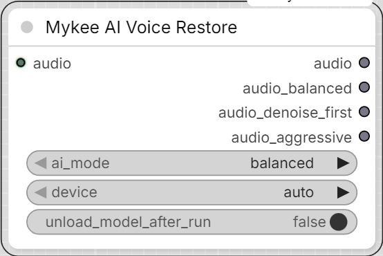

# Mykee AI Voice Restore

[← Back to the main README](../README.md)  ·  Category: `Mykee/Audio`

  

Runs VoiceFixer (https://github.com/haoheliu/voicefixer), a model trained
specifically to restore degraded speech (denoise + de-reverb + bandwidth
extension in one pass) while preserving the speaker's own
identity/voice. Stronger than **Mykee Audio DSP Cleanup** alone,
especially for reverb/room tone the DSP node doesn't specifically
address - but slower, and needs a GPU for reasonable speed.

- **ai_mode** - `balanced` (mode 0, VoiceFixer's default) /
  `denoise_first` (mode 1 - strips very harsh/high-frequency noise before
  restoring; try this if `balanced` leaves noise artifacts) / `aggressive`
  (mode 2 - VoiceFixer's own "more effective on seriously damaged speech"
  mode; can sound less natural on already-decent audio) / `all` - runs
  all three and gives you a separate output *per mode*, e.g. to A/B them
  with a Preview Audio on each, instead of one blended result.
- **device** - `auto`/`cuda`/`cpu`.
- **unload_model_after_run** - frees VoiceFixer from VRAM once the run
  finishes, via ComfyUI's own model manager. Off by default.

**Outputs:** `audio` carries the result for the `balanced`/
`denoise_first`/`aggressive` modes; `audio_balanced` /
`audio_denoise_first` / `audio_aggressive` carry nothing in that case.
For `all`, it's the reverse: `audio` carries nothing, and the three
named outputs each carry their own mode's result. "Carries nothing"
means that output doesn't fire at all for that run (via ComfyUI's
`ExecutionBlocker`) - any node relying solely on it simply doesn't
execute, rather than receiving an empty/`None` value.

VoiceFixer only supports 44100 Hz mono, so stereo input is downmixed;
every output is always resampled back to the *original* input's sample
rate, so this node's output rate matches its input rate. Output is mono
regardless of the input's channel count - chain **Mykee Audio DSP
Cleanup** after this if you specifically need a stereo result (it will
just apply the same processing to the single channel).

A batched `AUDIO` input is processed per-item; results are re-padded
with trailing silence to a common length afterward.

**Models:** downloaded automatically (from Zenodo, a few hundred MB
total) into `ComfyUI/models/VoiceFixer/`, the first time this node is
actually used. Requires the `voicefixer` pip package to be installed
(see `requirements.txt`) and network access to zenodo.org on that first
use.

VoiceFixer's own checkpoint-fetching code has **no** built-in option to
redirect where it downloads to - left alone, it would always use
`~/.cache/voicefixer/` (on Windows, `%USERPROFILE%\.cache\voicefixer\`),
not a shared `ComfyUI/models/...` folder like this pack's other AI
nodes. This node works around that the same way it already redirects
Seed-VC's and Demucs's own downloads (`HF_HUB_CACHE`/`TORCH_HOME`):
by briefly overriding the `HOME`/`USERPROFILE` environment variables -
what `expanduser("~")` actually reads - for just the moment VoiceFixer's
checkpoint-download code runs, then restoring them immediately after.

## Limitations

Handles only a single (best-score or largest) face per image - in
multi-person scenes, if the character you're after isn't unambiguously
the best match, you need to manually pre-select/crop the reference.
DINOv2's "subject" embedding is not face-specific, so it can give a high
similarity for the same person even across a clothing/pose change - it's
good as a rough estimate of body-shape/overall-look consistency, not as
identity-deciding evidence.
