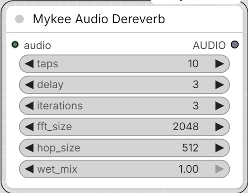

# Mykee Audio Dereverb

[← Back to the main README](../README.md)  ·  Category: `Mykee/Audio`

  

Reduces room reverb/echo via WPE (Weighted Prediction Error) - a
classical, non-neural late-reverberation suppression algorithm (not a
generative/voice-conversion model, so it can't alter the speaker's
timbre). Well-established in speech processing (used e.g. in the REVERB
Challenge baseline, Kaldi, ESPnet) - see
https://github.com/fgnt/nara_wpe, the library this node wraps. Kept as
its own node (not folded into Mykee Audio DSP Cleanup) so it can go
anywhere in the chain relative to the other Mykee audio nodes - e.g.
before Mykee AI Voice Restore, so the AI stage receives an already-
dereverbed signal.

- **taps** - filter length (STFT frames) used to predict/cancel the
  reverb tail. More can suppress a longer tail but costs more compute
  and, past a point, can start coloring the sound.
- **delay** - STFT frames right after the direct sound left untouched (a
  guard interval) - WPE only targets reverb *after* this, not early
  reflections/the direct sound itself.
- **iterations** - how many times WPE re-estimates its prediction filter
  against its own output; more can sharpen the result, with diminishing
  returns and more compute time.
- **fft_size** / **hop_size** - STFT frame size/hop, in samples. The
  defaults suit 44.1/48kHz speech; lower them for a much lower sample
  rate input.
- **wet_mix** (0-1) - blends the dereverbed signal back with the
  original. 1.0 = fully dereverbed; lower it if the full effect sounds
  over-processed for your material, or if you just want to take the edge
  off rather than eliminate the reverb.

WPE's effectiveness varies a lot by recording - it's genuinely strongest
with real multi-microphone-array diversity (its original use case), and
more modest on a single mic or a plain stereo recording (not spaced
mics). There's no substitute for listening and adjusting
taps/delay/iterations/wet_mix by ear for your specific material.

This is a CPU-only, numpy-based algorithm (no GPU acceleration, no model
download) - runs at roughly 0.3-0.5x realtime on a typical desktop CPU,
so a long clip will take a while; there's a progress status while it
runs. A batched `AUDIO` input is processed per-item.
