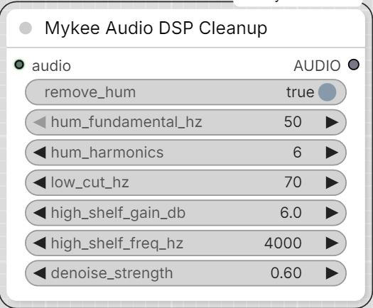

# Mykee Audio DSP Cleanup

[← Back to the main README](../README.md)  ·  Category: `Mykee/Audio`

  

Fast, dependency-light DSP fixes for a recording made without a
dedicated/close mic - distant, off-axis, "in the background": low,
wandering level; muffled tonal balance; audible mains hum; background
room noise. No model download, runs fine on CPU.

- **remove_hum** + **hum_fundamental_hz** (50/60 Hz) + **hum_harmonics** -
  notches out AC mains hum (the fundamental and that many multiples of
  it) - e.g. from an ungrounded cable or a nearby power supply the mic
  picked up.
- **low_cut_hz** - a gentle high-pass to remove room rumble/handling
  noise. 0 disables. Keep it below a male voice's fundamental (~85 Hz+)
  so it doesn't thin out the voice.
- **high_shelf_gain_db** + **high_shelf_freq_hz** - boosts frequencies
  above that point to restore some presence/air a distant or off-axis
  mic loses (the muffled/dull quality). 0 disables.
- **denoise_strength** (0-1) - reduces steady background noise via
  spectral subtraction against a profile learned from the quietest parts
  of the clip. 0 disables; higher is more aggressive but can start
  sounding processed on already-clean audio.

Pairs well chained with **Mykee Audio Leveling** (level drift/normalize)
and **[Mykee AI Voice Restore](ai-voice-restore.md)** - run this one first to clean up
hum before the AI stage, after to touch up presence on the AI stage's
output, or on its own for a fast fix that doesn't need a model download.

A batched `AUDIO` input is processed per-item; results are re-padded
(silence/channel-repeated) to a common shape afterward.
