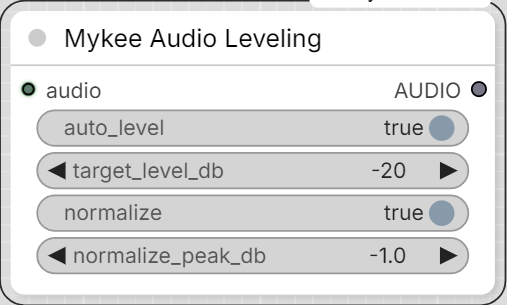

# Mykee Audio Leveling

[← Back to the main README](../README.md)  ·  Category: `Mykee/Audio`

  

Fixes level drift/wandering in an `AUDIO` clip - e.g. a speaker who moved
closer to/further from the mic mid-recording - and/or normalizes its
overall peak loudness. Two independent stages, either can be switched
off on its own:

1. **auto_level** + **target_level_db** - rides the gain toward a
   consistent target RMS loudness, smoothed with attack/release so it
   doesn't pump on every syllable, with a hard peak-safety ceiling so it
   never introduces clipping regardless of how much gain the level
   target alone would otherwise call for. That ceiling itself eases in
   fast but releases slowly, so a single loud transient in an
   otherwise-quiet recording doesn't produce an audible momentary
   dip-and-recover right on the transient.
2. **normalize** + **normalize_peak_db** - a final overall gain trim so
   the clip's loudest peak sits at exactly `normalize_peak_db`, for
   consistent headroom across multiple clips.

Runs `auto_level` first (if on), then `normalize` (if on). Kept as its
own node (not folded into Mykee Audio DSP Cleanup) so it can go anywhere
in the chain relative to this pack's other audio nodes.
