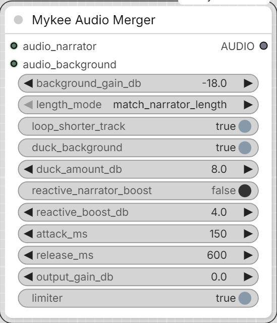

# Mykee Audio Merger

[← Back to the main README](../README.md)  ·  Category: `Mykee/Audio`

  

Two-input audio mixer: `audio_narrator` (foreground, e.g. TTS narration) +
`audio_background` (ambience/noise bed) -> one merged `AUDIO` output.
`audio_narrator`'s sample rate and channel layout are used as the output
reference; `audio_background` is resampled/channel-matched to it
automatically.

- **background_gain_db** - base level of the background relative to the
  narrator, before ducking.
- **length_mode** - which track's length the merged output follows
  (`match_narrator_length` / `match_background_length` /
  `match_longer_length`); the other track is looped or silence-padded to
  fit, per `loop_shorter_track`.
- **duck_background** + **duck_amount_db** - sidechain ducking: the
  background is automatically attenuated while the narrator is speaking.
- **reactive_narrator_boost** + **reactive_boost_db** - Lombard-effect
  style reaction: the narrator gets a bit louder when the background gets
  louder (e.g. a wind gust). Gain-only (no pitch/formant shifting), so it
  doesn't touch the narrator's voice character/accent.
- **attack_ms** / **release_ms** - how fast the ducking/reactive boost
  reacts to, and relaxes back from, a level change.
- **output_gain_db** - final trim.
- **limiter** - soft-clips (tanh) the merged output to prevent digital
  clipping; only audibly colors the sound near/above 0 dBFS peaks.

The ducking/reactive-boost envelopes are computed at a low control rate
(200 Hz) for speed, each track's amplitude is peak-normalized to its own
maximum before being applied - so `duck_amount_db`/`reactive_boost_db`
describe the effect at each track's own loudest moment, not an absolute
dB threshold. If the merge sounds off, that's the first thing worth
tuning by ear per source pair.
