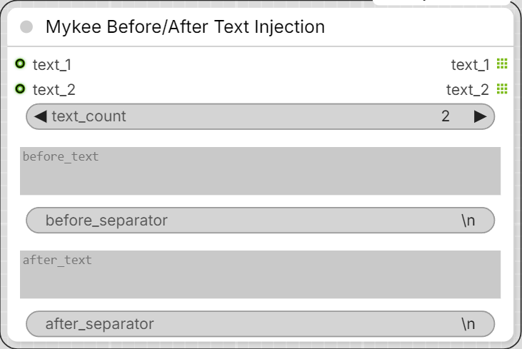

# Mykee Before/After Text Injection

[← Back to the main README](../README.md)  ·  Category: `Mykee/Prompt`

  

Puts the same text in front of and after many texts at once: every
**text_N** input comes out on its own **text_N** output as

    before_text + before_separator + text + after_separator + after_text

- **text_count** - number of input / output pairs, 1-50 (default 2).
- **before_text** / **after_text** - what goes in front of / after every
  text.
- **before_separator** / **after_separator** - default `\n` (new line;
  `\t` = tab). A separator is only used when its text is not empty: an
  empty before_text also drops before_separator, an empty after_text drops
  after_separator.

An input that is not connected (or an empty text) gives only the before
and after text, joined by before_separator.

Lists are kept per pair: a list input (e.g. the batch output of Mykee Text
Switch/Batch) comes out as a list of the same length on its own output,
without affecting the other pairs.

Bypass: a bypassed node passes every text_N input straight through to its
text_N output, unchanged. For that the text inputs have to be the node's
only sockets, so the widgets (before / after texts, separators,
text_count) cannot be converted to inputs.
