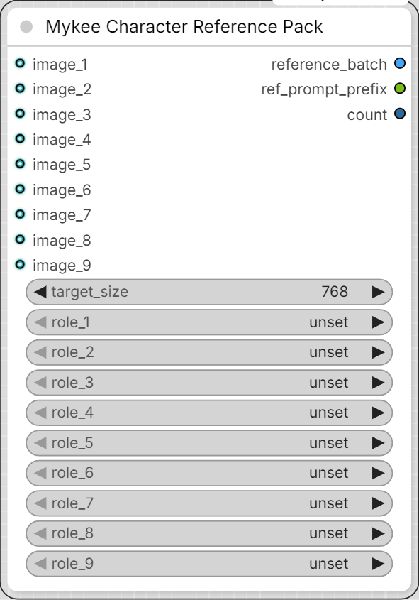

# Mykee Character Reference Pack

[← Back to the main README](../README.md)  ·  Category: `Mykee/Character`

  

Up to 9 `image_N` inputs (each with an optional `role_N`:
face/body/cloth_top/cloth_bottom/other), from which it builds a
common-size-scaled `reference_batch` (IMAGE) and a `ref_prompt_prefix`
(STRING, e.g. `<Picture 1> <Picture 2> <Picture 3>`) - built exactly the
way MiniMax H3's native reference-to-video node and prompt are structured.
`reference_batch` can be connected directly to the native "MiniMax H3
Reference to Video" node's image input; `ref_prompt_prefix` can be
prepended to the final prompt with a String Concatenate node.
