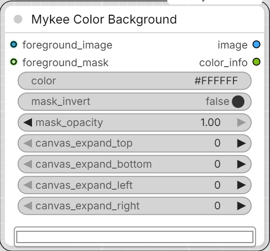

# Mykee Color Background

[← Back to the main README](../README.md)  ·  Category: `Mykee/Image`

  

Composites a foreground image (optionally with a mask acting as its alpha
channel) onto a solid color background - the same idea as comfy_mtb's
["Colored Image"](https://github.com/melMass/comfy_mtb) node, but with a
proper top-level color widget instead of comfy_mtb's old dedicated
custom-button widget: a normal hex text field (typable, and right-click
-> "Convert widget to input" to drive it from a STRING output) with a
live native color-picker swatch underneath it, always showing the
currently selected color.

- **foreground_image** (IMAGE, required) - the image to composite. Its
  own size is what `canvas_expand_*` (below) grows outward from.
- **foreground_mask** (MASK, optional) - the foreground's alpha channel.
  If not connected, the foreground is treated as fully opaque (only the
  `canvas_expand_*` padding, if any, shows the background color).
- **color** - background color as a hex code, e.g. `#FF8800`. Type it
  directly, pick it with the swatch, or convert it to a STRING input.
- **mask_invert** - inverts `foreground_mask` before it's used as the
  alpha channel. Affects the composited output image only, not the mask
  input itself.
- **mask_opacity** (0-1) - scales the mask's alpha. `1.0` = use the mask
  as-is; `0.0` = fully transparent (only the background color shows).
- **canvas_expand_top / bottom / left / right** (pixels, default `0`) -
  grows the canvas beyond the foreground image's own size in that
  direction, filled with the background color.

Outputs:

- **image** (IMAGE) - the composited result.
- **color_info** (STRING) - the resolved background color as a
  normalized `#RRGGBB` hex code.
