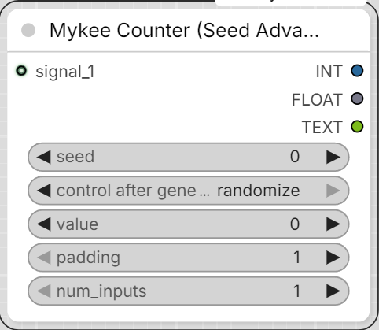

# Mykee Counter (Seed Advanced)

[← Back to the main README](../README.md)

  

Same as "Mykee Counter", plus a dedicated **seed** (INT) field:

- The `seed` widget can be typed by hand, or turned into a connectable
  socket via right-click -> *"Convert widget to input"* (e.g. to feed it
  from a seed generator node).
- If `seed`'s value **differs** from the previous run: `value` resets to
  zero, then in the same run it checks the active `signal_N` inputs as
  usual - if one carries a signal, it advances from 0 to 1.
- If `seed` has **not changed**: everything proceeds per the usual
  "Mykee Counter" logic (advances from the current `value` if there's a
  signal).
- On the very first run (no prior value to compare against), this does
  not count as a change - the node starts normally.
- The node keeps the last-known `seed` value in the ComfyUI server's
  memory, keyed by the node's unique id (`unique_id`) - this persists
  until the server restarts.

## Note

The dynamic socket handling (showing inputs based on `num_inputs`) works
through ComfyUI's JS frontend. If you call the node purely via the API
(without the frontend), the Python side still only looks at the first
`num_inputs` `signal_N` inputs, regardless of how many you actually
connected.
