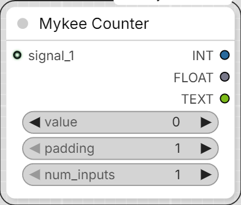

# Mykee Counter

[← Back to the main README](../README.md)

  

- **value** (INT) - the counter's current value. Can be overwritten by
  hand at any time before running (queuing) - counting then continues
  from there. After every run, the node automatically writes the new
  value back here.
- **padding** (INT, 1-10) - number of digits in the `TEXT` output.
  E.g. `padding = 1` -> `"1"`; `padding = 5` -> `"00001"`.
- **num_inputs** (INT, 1-50) - how many `signal_N` input sockets should be
  active. Increasing/decreasing this dynamically shows/hides sockets on
  the node (a connected socket is never removed automatically).
- **signal_1 ... signal_50** - inputs of any type (can be connected to any
  node's output). Only the first `num_inputs` of these are active.

## Outputs

- **INT** - the counter's new value as an integer.
- **FLOAT** - the same, as a float.
- **TEXT** - the value as text, zero-padded per `padding`.

## Logic

- The counter starts at `0` and is always a whole number (no decimals).
- If **any** of the active `signal_N` inputs receives data (not `None`),
  the counter increases by **exactly one**. If several inputs receive a
  signal in the same run, that only advances the counter once (it stops
  at the first match and doesn't check further).
- If none of the active inputs receive a signal (e.g. not connected, or
  the source node is inactive/disabled and so produces no output), the
  node does not raise an error - it simply doesn't advance the counter,
  and the current `value` passes through on the outputs.

## Note

The dynamic socket handling (showing inputs based on `num_inputs`) works
through ComfyUI's JS frontend. If you call the node purely via the API
(without the frontend), the Python side still only looks at the first
`num_inputs` `signal_N` inputs, regardless of how many you actually
connected.
