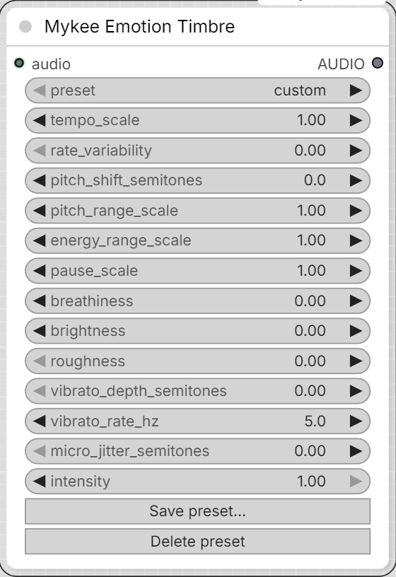

# Mykee Emotion Timbre

[← Back to the main README](../README.md)  ·  Category: `Mykee/Audio`

  

Also WORLD-vocoder-based, but built around what the emotional-speech-
prosody literature actually says drives perceived emotion in a voice:
**pitch range/variability, speaking rate (and how evenly it's paced),
loudness dynamic range, and pause length/frequency** - not static voice
timbre. (E.g. Yildirim et al. 2004; Major & Chatterjee's 2026 RAVDESS
analysis: anger/happiness show wider pitch range, higher rate, shorter
pauses; sadness shows the narrowest pitch range, slower rate, longer/more
pauses.) Voice-quality color (breathiness, brightness, roughness, vibrato)
is layered on top as a secondary cue, same as before.

Primary controls:
- **tempo_scale** / **rate_variability** - overall speed, plus optional
  uneven/erratic pacing on top of it (rushing and catching itself, rather
  than a perfectly steady speed change).
- **pitch_shift_semitones** / **pitch_range_scale** - register, and how
  much the pitch moves around its own median (narrow = monotone/sad,
  wide = animated/anger-happiness).
- **micro_jitter_semitones** - a small amount of natural-sounding random
  pitch flutter. Mainly useful
  when `pitch_range_scale` is pushed far from 1.0 and the result starts
  sounding too clean/robotic.
- **energy_range_scale** - loudness dynamic range (flat/subdued vs. quiet
  parts quieter and loud/shouted parts louder).
- **pause_scale** - independently stretches or compresses just the
  low-energy, pause-like stretches of the recording (auto-detected from
  the WORLD spectral envelope's frame energy) - speech portions keep
  their own rate. This is what actually produces "more/longer pauses" for
  sadness or "short, clipped pauses" for anger, rather than a uniform
  slowdown/speedup.

Secondary controls (same as the first version): **breathiness**,
**brightness**, **roughness**, **vibrato_depth_semitones** /
**vibrato_rate_hz**.

A **preset** dropdown (`custom` + whatever's in `mood_presets.json`, in
the pack's root folder) is a saved combination of all of the above.
Picking a named preset loads its values into the sliders and keeps
showing that preset's name - it does not silently reset to `custom`.
Changing any slider by hand, though, does switch the dropdown to
`custom`, since the label should never claim a mood that isn't actually
what's about to run.

**Save preset...** and **Delete preset** buttons on the node let you
manage `mood_presets.json` from inside ComfyUI - no manual file editing,
no restart needed. Save prompts for a name (overwrites if it already
exists) and writes the current slider values; Delete removes the
currently-selected preset. `custom` can't be saved over or deleted. (This
needs ComfyUI's own server running, since saving/deleting writes to disk
through a small API the node pack registers - `web/mykee_emotion_timbre.js`.
If you ever want to add moods by hand instead, editing `mood_presets.json`
directly still works exactly as before and shows up without a restart
too, since the dropdown re-fetches the current preset list.)

Shipped starting points (grounded in the literature above but not
measured on any particular voice - tune by ear, then Save over them):
`neutral`, `sad`, `dreamy`, `angry`, `longing`, `tired`, `excited`.

- **intensity** - blends every parameter above toward its neutral value
  (not a waveform crossfade - tempo/pause changes alter the output's
  duration, so a sample-domain dry/wet blend wouldn't line up once the
  two aren't the same length anymore).

(The rate_variability pacing noise and roughness/shimmer randomization
use a fixed internal seed - no user-facing seed control, since neither
is meant to be a "roll the dice for a different take" kind of random.)

Note: because tempo/pause changes actually change duration, this node's
output can be noticeably shorter or longer than its input - keep that in
mind if you're syncing to a fixed-length video track.

Note: `energy_range_scale`/`energy_emphasis` (this node and Mykee Prosody
Shaper) only reshapes the dynamics of stretches that already have some
real signal in them - near-silent stretches (pauses, the WORLD vocoder's
own residual noise floor) are left at their original level regardless of
the scale, via a gate relative to the loudest frame in the clip. Without
this, flattening the dynamics (scale < 1, e.g. most "quieter/sadder"
presets) would pull those near-silent stretches up toward the loudness
median too, audibly raising the noise floor in every pause.

The same gate applies to `breathiness`, `brightness`, and `roughness`:
they only color frames that have real signal in them, not pauses/silence.
Without it, breathiness in particular ended up sounding like a constant
low-level air/mic-noise layer present even in gaps between phrases,
rather than a quality of the voice itself only while it's actually
speaking.

Note: `pause_scale` only stretches/compresses stretches of at least
~150ms - shorter low-energy dips (a stop-consonant closure, for example)
are never treated as a pause. Without this, brief closures could get
warped along with real pauses, which occasionally smeared a fast
consonant transition into a buzzy, noise-like texture.

Note: `breathiness`, `roughness`, `brightness`, and the tempo/pause warp
are each individually subtle at moderate values, but they compound - on
a loud, sustained vowel, stacking several of them together (as most
presets do) measurably softens harmonic clarity even though no single
one of them is doing anything dramatic on its own. The shipped presets
keep breathiness/roughness modest for exactly this reason. If a preset
still sounds textured/noisy to you on a particular vowel, that's the
first place to back off - and `intensity` scales all of it down
uniformly if you'd rather keep the preset's balance and just reduce the
total effect.

Note: both nodes' final safety stage is a linear peak-scale-down (never
up), not a soft-clip/tanh limiter - a limiter adds harmonic distortion
whenever it actually engages, and since breathiness/brightness/roughness
each add a bit of extra energy on top of the original signal, a source
that's already sitting at or near 0 dBFS (common for TTS output) has
zero headroom to absorb that. Linear scaling only ever changes overall
level, never the waveform's shape, so it can't itself be a source of the
"noisier than the input" complaint the way a hard limiter can.

## Note on the pyworld/pkg_resources install quirk

`pyworld` imports `pkg_resources` at load time just to read its own
version string, but recent `setuptools` versions no longer ship
`pkg_resources`. Rather than pinning `setuptools` to an old version
(fragile - torch, ComfyUI, or any other package can bump it back up
later), `mykee_prosody.py` stubs out just that one call with the
stdlib's `importlib.metadata` if `pkg_resources` isn't available, so
this works regardless of whatever `setuptools` version ends up
installed. If a real `pkg_resources` is present, the shim gets out of
the way and isn't used.

Mykee Emotion Timbre can be chained
directly into **Mykee Audio Merger**'s `audio_narrator` input.
