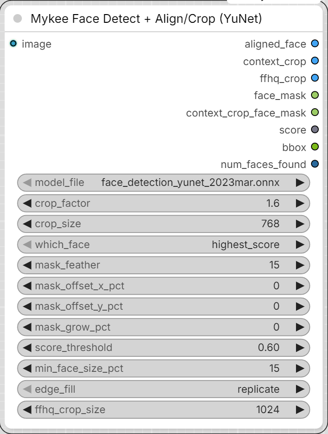

# Mykee Face Detect + Align/Crop (YuNet)

[← Back to the main README](../README.md)  ·  Category: `Mykee/Character`

  

Input: an image. Finds the best face with YuNet (`highest_score` or
`largest`), and returns three crops:
- `aligned_face` - 112x112, aligned via the similarity transform computed
  from the 5 landmarks (eyes level) - this feeds the SFace embedding
  node.
- `context_crop` - sized by `crop_factor` (a direct multiple of the face
  bbox's larger side - same convention as Impact-Pack's FaceDetailer
  `bbox_crop_factor`, so the two are directly comparable: `crop_factor=1.0`
  is a tight crop, `3.0` matches a typical FaceDetailer setting) and
  scaled to `crop_size` - this is the "clean, contextual reference" worth
  feeding into your Krea 2 / MiniMax H3 workflow (Inline Studio's own
  documentation also notes that results are better when references are
  cropped, and you don't, say, mix the face into a clothing reference).
- `ffhq_crop` - NVIDIA's actual FFHQ dataset alignment recipe (eye/mouth-
  based rotation+crop - not a plain resize), scaled to `ffhq_crop_size`.
  Feed THIS into the StyleGAN Editor node's `image` input instead of a
  plain resize/crop - a `stylegan2-ffhq-*.pkl` generator's own latent
  space was trained on exactly this framing, so GAN-inversion projects
  much more faithfully onto it than onto an arbitrary crop (a loose
  portrait with lots of background/shoulders, say, tends to make the
  projection collapse into something distorted - see "Notes / caveats" in
  the [StyleGAN section](stylegan.md#notes--caveats)). Uses `edge_fill` for its own padding, same as
  `context_crop`. Falls back to a resized `context_crop` on the rare
  degenerate-landmark case (near-collinear eyes/mouth) rather than
  failing the node.
- `face_mask` - a feathered mask of the face region at the original
  image's resolution; can be connected to a regional-conditioning node's
  mask input (e.g. so identity reinforcement acts mainly on the face).
- `score`, `bbox` - detection confidence and the raw bbox as text.
- `num_faces_found` - how many faces were found in total, AFTER the
  `min_face_size_pct` filter (if you expected/got more than two, this
  tells you to check the `which_face` choice, `score_threshold`, or
  `min_face_size_pct`).

When there are multiple faces (e.g. a two-person image), `which_face` can
now also select by position, not just `highest_score`/`largest`:
`leftmost`/`rightmost`/`topmost`/`bottommost` - useful if your prompt also
distinguishes people as "the person on the left", and you need to know
which generated face belongs to whom (e.g. before Identity Score-ing).

For layouts where faces share almost the same x or y (e.g. a character
sheet with front / side / back views plus two faces stacked on the right),
the single-axis options are not enough, so there are more:

- `top_left` / `top_right` / `bottom_left` / `bottom_right` - the face
  closest to that corner of the image (diagonal score on the face centers,
  normalised by image size). On such a sheet, `top_right` and
  `bottom_right` pick the upper and lower stacked face.
- `x_order` / `y_order` + **`face_index`** - sorts ALL detected faces
  left-to-right / top-to-bottom and picks the one at `face_index`
  (0 = first), so you can step through the detections one by one. An index
  past the last face is clamped to the last one; `num_faces_found` tells
  you the count.

**`min_face_size_pct`** - before `which_face`'s position-based selection
(leftmost/rightmost/etc.) runs, this filters out detections that are too
small relative to the largest detected face. Without it, a false-positive,
tiny background detection (e.g. a patterned bush, a fabric print) could
easily get picked as the "most extreme" face over a real, large face, if
it happens to sit at the edge of the image - this is exactly the bug that
can show up on two-person generated images.

`context_crop` is always a true square (no distortion on resize), even
when the face is close to the image edge: the missing margin is filled
per the `edge_fill` parameter - `replicate` by default (extends the edge
pixel row, safe, no duplicated features). `reflect` can duplicate features
(eye, ear) near the face - only pick this if you know the crop_factor margin
doesn't reach into face detail; `constant_gray`/`constant_black` give a
solid-color fill.

**There are two mask outputs - don't mix them up:**
- `face_mask` - in the ORIGINAL, uncropped image's resolution/coordinates.
  Only use this if the downstream node's image input also receives the
  original, full image.
- `context_crop_face_mask` - in `context_crop`'s OWN coordinate
  system/resolution (the same crop+resize transform is applied as for
  context_crop). If you feed `context_crop` as `image_1` into a node like
  Krea 2's "Reference Latent+" (`mask_1` input), connect THIS one - the
  plain `face_mask` would land in the wrong place/scale, since it's in a
  different coordinate system.

Both masks are ROTATED to match the head's tilt (using the angle computed
from the two eye landmarks), not a plain axis-aligned bbox - so a tilted
head won't have the mask spill out of the head/hair, or clip off real
face area on the other side.

**`mask_offset_x_pct` / `mask_offset_y_pct`** - corrects the center used
for BOTH `context_crop`'s crop window and both masks together, as a
percentage of the detected face's own width/height - they all move
together, so the mask keeps lining up with what `context_crop` actually
shows. `aligned_face` is unaffected (it's built from the 5 landmarks
directly, not the bbox center). Useful when YuNet's raw bbox center isn't
quite where you want the face framed (glasses, a receding hairline, or an
unusual angle can all throw it off slightly).

**`mask_grow_pct`** - grows (positive) or shrinks (negative) both masks
around their own (possibly offset-corrected) center, as a percentage of
the face's width/height. Deliberately separate from `crop_factor`: that
only changes how much surrounding context `context_crop` includes, not
the mask rectangle's own size - use `mask_grow_pct` when you want a
bigger/smaller mask at the same crop framing, not a bigger/smaller crop.
Only affects the masks, not `context_crop`/`aligned_face`.

**`ffhq_crop_scale`** - zoom for `ffhq_crop` only. `1.0` (default) is the
exact FFHQ framing; above `1.0` zooms out (more hair, shoulders,
background - e.g. `1.2`-`1.4` if the top of the hair gets cut off), below
`1.0` zooms in. The crop stays centered on the FFHQ anchor point and keeps
its rotation. Any value other than `1.0` leaves the framing the
`stylegan2-ffhq-*.pkl` generators were trained on, so StyleGAN projection
may be slightly less faithful. It does not affect `context_crop` or
`aligned_face`.

**`context_rotate`** - `off` (default) keeps `context_crop` axis-aligned, so
the head's tilt stays as in the source. `level_eyes` rotates the crop
around the (offset-corrected) face center so the line between the eyes is
horizontal. `crop_factor`, `mask_offset_*` and `edge_fill` work as before
(`edge_fill` can now also show up at the corners). `context_crop_face_mask`
follows the rotation (an upright rectangle in the middle of the crop).
`face_mask` stays in the original image's coordinates, unchanged.

**`context_frame`** - how `context_crop`'s window is centered and sized.
`bbox` (default, the old behavior) uses YuNet's bbox. Note that YuNet's bbox
runs roughly from the eyebrows to the chin, so its center sits around the
nose/mouth: with a small `crop_factor` the crop can cut off the eyes, and
with a larger one the face sits too high in the frame. `landmarks` centers
and sizes the window from the eye/mouth landmarks (the same geometry
`ffhq_crop` uses), which is much steadier. In this mode `crop_factor=2.0`
gives the same window size as `ffhq_crop`, and `1.0` is half of that (a tight
face crop). `mask_offset_*` still shifts the window; both masks keep
following the detected face box.
