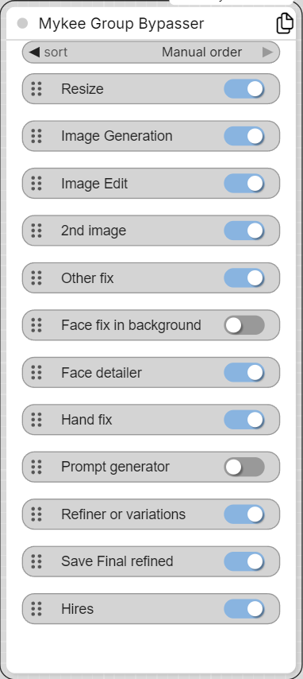

# Mykee Group Bypasser

[← Back to the main README](../README.md)  ·  Category: `Mykee/Utils`

  

A frontend-only (virtual) node that shows **one on/off switch per Group**
in the current workflow. Flipping a switch sets every node inside that
group to *Always* (ON) or *Bypass* (OFF) - so you can enable/disable whole
sections of a workflow (e.g. "Upscale", "Face detail", "Audio clean-up")
from a single place, without hunting for each group on the canvas.

The node has no inputs or outputs and never runs on the Python side; it
is skipped entirely when the workflow is converted into an API prompt,
so it adds nothing to the execution.

## How it works

- Every group in the graph gets a row with its title and a switch. A
  node counts as being "in" a group when its center lies inside the
  group's rectangle.
- A switch is shown as OFF only when **all** nodes in the group are
  bypassed. Each row re-syncs itself regularly, so if you change a
  group's nodes some other way (the group's own header switch, another
  bypasser node, a manual Bypass), the switch follows.
- Groups added, renamed, moved or deleted are picked up automatically.
  The right-click menu also has a **Refresh** item.
- Colors follow whatever ComfyUI color theme (dark/light/custom) is
  active.

## Sorting the switches

The order of the switches can be set with the **sort** widget on the
node:

- **Position (top to bottom)** (default) - by the group's place on the
  canvas: top to bottom, then left to right.
- **Execution order** - groups are ranked by the earliest node they
  contain, in ComfyUI's own execution order. So the switches come in the
  order the workflow actually runs.
- **Manual order** - a fully free order. A drag handle appears on the
  left of each row: grab it and drag the row to its new place; the other
  rows slide smoothly aside. The order is stored in the workflow and
  survives saving/loading (groups identified by their title). To go back,
  right-click the node -> **Clear manual order (revert to Position)**.

In **Position** and **Execution order** mode a group nested inside
another group is always listed right after its (closest) parent group.
Manual mode ignores nesting - it is a flat list.

## Copy button

The copy icon in the node's title bar copies every currently **active**
(non-bypassed) group listed here - together with all the nodes inside
them - to the clipboard, in ComfyUI's own copy/paste format. You can
paste it straight into another workflow with Ctrl+V. The icon briefly
turns into a check mark when the copy succeeded.

## Notes

- Group titles are used to identify groups (for the manual order), so
  give your groups unique names.
- Because the switch works on the nodes' mode, it overrides whatever
  Bypass/Always state those nodes had before.
