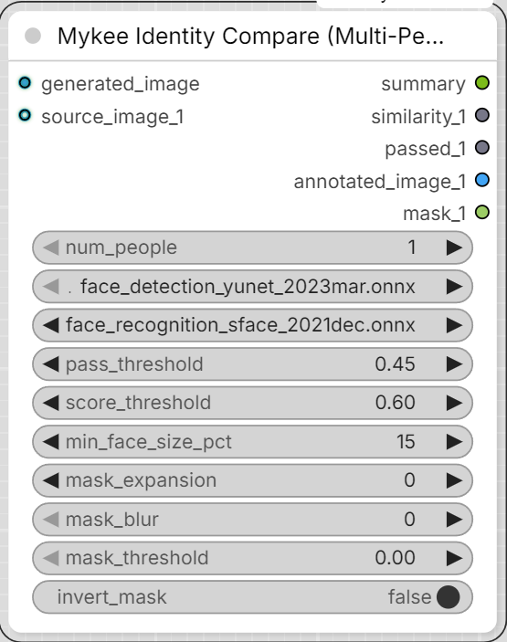

# Mykee Identity Compare (Multi-Person)

[← Back to the main README](../README.md)  ·  Category: `Mykee/Character`

  

An all-in-one convenience node - no need to build a separate Face Detect +
Face Embed chain; it takes images directly:
- `generated_image` - the generated image to evaluate
- `num_people` (1-10) - a live switch: adds/removes the `source_image_N`
  inputs and the `similarity_N`/`passed_N`/`annotated_image_N`/`mask_N`
  outputs to match, so the node only shows as many "slots" as you
  actually need
- `source_image_1` ... `source_image_N` - one reference image per person

Every face detected in `generated_image` is compared against every
connected `source_image_N`. A reference person can appear MORE THAN ONCE
in `generated_image` (e.g. a side-by-side comparison of several
takes/generations of the same person) - so every detected face that
scores at or above `pass_threshold` against that reference counts as a
match, not just the single highest-scoring one. `similarity_N`/
`passed_N` report the single BEST match found (a simple pass/fail
number); `annotated_image_N` boxes/labels EVERY matching face for that
person (green if it passed, red if not - if nothing passed, the closest
attempt is still shown, labelled MISMATCH, so the output isn't blank);
`mask_N` is a MASK covering that same set of matching face(s) (a union
of their bounding boxes), ready to wire straight into a face-editing/
inpainting node without a separate detection step.

`mask_expansion`/`mask_blur`/`mask_threshold`/`invert_mask` (applied in
that order) shape every `mask_N` output the same way:
- `mask_expansion` - grows (positive) or shrinks (negative) the mask, in
  pixels, via dilate/erode.
- `mask_blur` - softens the edge with a Gaussian blur (radius in pixels,
  applied after expansion).
- `mask_threshold` - only used when `mask_blur` > 0; re-binarizes the
  blurred mask at this cutoff, removing the soft edge the blur left. 0 =
  disabled, keeping a soft/feathered edge.
- `invert_mask` - selects everything EXCEPT the matched face area(s)
  instead. A person with no match at all (not connected, or nothing
  detected) gets an all-zero mask (all-one if `invert_mask` is on).

A face-detection failure for one particular `source_image_N` (e.g. no
face found because `score_threshold`/`min_face_size_pct` was set too
aggressively) no longer aborts the whole node - it shows a non-blocking
ComfyUI toast notification and that one person is skipped
(`similarity_N=-1`, `passed_N=False`, blank `mask_N`) while everyone else
is still matched normally. `summary` (STRING) is a human-readable
breakdown of every match, mismatch, and warning - connect it to a Show
Text node.

This node also has a `min_face_size_pct` parameter (15% by default):
without it, a false-positive, tiny background detection could easily get
matched as a "person" over a real face - which is exactly what
`annotated_image_N`/`mask_N` would then show (the box/mask sitting on
the false detection instead of the real face).
