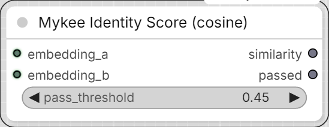

# Mykee Identity Score (cosine)

[← Back to the main README](../README.md)  ·  Category: `Mykee/Character`

<p align="center">
  
</p>

Cosine similarity between two embeddings (either can be a face or subject
embedding, as long as both inputs have the same dimensionality).
`similarity` (FLOAT) + `passed` (BOOLEAN, per `pass_threshold`) - this
lets you automatically filter/rank generated takes by how faithfully they
match the reference identity.

**IMPORTANT:** this node does NOT take an image - it wants the output of
the `Face Embed (SFace)` or `Subject Embed (DINOv2)` node. The correct
chain, for both the reference AND the generated image, separately:
```
image -> Face Detect+Align/Crop -> aligned_face -> Face Embed (SFace) -> face_embedding
```
and you connect the two `face_embedding` outputs to Identity Score's
`embedding_a`/`embedding_b` - not the images themselves. If someone
accidentally connects an image anyway, the node now detects this and
gives a clear error message instead of silently computing a meaningless
result.

If the generated image has more than one person, use the
`which_face: leftmost`/`rightmost` option (see [Face Detect + Align/Crop](face-detect-align-crop-yunet.md)) to pick whose face
to crop out with the Face Detect+Align/Crop node and compare against the
right reference.
