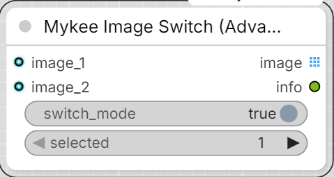

# Mykee Image Switch (Advanced)

[← Back to the main README](../README.md)  ·  Category: `Mykee/Image`

  

Same idea as Mykee Image Switch, but with any number of image inputs
instead of a fixed 2 - the node starts with `image_1`/`image_2`, and a
new empty input appears automatically as soon as you connect something
to the currently-last one, so there's always a free slot to grab next.
Disconnecting trims trailing empty inputs back down to a single spare
(never below `image_1`/`image_2`, and never touching a socket that's
still connected).

Same important caveat as the base switch applies: `switch_mode` OFF is
**batch mode** (see below), and "disabling the switch" means turning
that widget off, **not** ComfyUI's own node Bypass/Mute on this node
itself - see the [base switch's page](image-switch.md) for why.

- **switch_mode** (BOOLEAN, default ON) - ON = switch mode (`selected`
  picks which active input to use); OFF = **batch mode** (every active
  input is passed through one after another, each at its own original
  size, in `image_1`, `image_2`, ... order).
- **selected** - which input number to use when `switch_mode` is ON and
  more than one input is active. Must be one of the currently active
  input numbers - if it isn't, the node raises an error rather than
  guessing. Ignored when only one input is active, or in batch mode.
- **image_1, image_2, ...** (IMAGE, optional, dynamic).

Behavior:

- switch ON, exactly one input active -> that one, regardless of
  `selected` (auto-passthrough).
- switch ON, 2+ inputs active -> `selected` must name one of the active
  inputs, or execution stops with a real error - this is a deliberate
  mistake on your part (you picked an input you know is empty), so it
  stays a hard error rather than being silently forgiving.
- switch ON, none active -> the `image` output is blocked (via
  ComfyUI's `ExecutionBlocker`) for anything downstream that needs it -
  no hard crash/traceback, other independent parts of the workflow keep
  running. Older ComfyUI versions without `ExecutionBlocker` fall back
  to a plain error instead.
- batch mode, 2+ inputs active -> all of them pass through as a real
  ComfyUI *list* (`OUTPUT_IS_LIST`), in `image_1`, `image_2`, ... order -
  not merged into one stacked tensor, so each keeps its own original
  width/height, no resizing. Downstream nodes (Mykee Color Background,
  Save Image, ...) automatically run once per image at that image's own
  size (ComfyUI's built-in list processing). The trade-off: a node that
  specifically wants one true multi-frame batch tensor for batched
  inference runs once per image instead of once for all of them.
- batch mode, exactly one active -> that one, unbatched.
- batch mode, none active -> same blocked-output behavior as above.

Outputs:

- **image** (IMAGE) - technically always a ComfyUI *list* under the
  hood (`OUTPUT_IS_LIST`), so downstream nodes run once per image in
  batch mode; a single-image case (switch mode, or only one active) is
  just a length-1 list, which behaves identically to a plain single
  image for anything consuming it - no difference to notice there.
- **info** (STRING) - a short human-readable note on which branch was
  used (or how the batch was assembled) and why, useful for debugging a
  graph.
