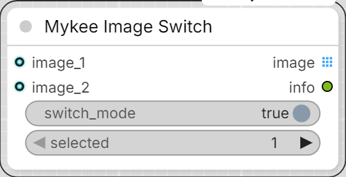

# Mykee Image Switch

[← Back to the main README](../README.md)  ·  Category: `Mykee/Image`

  

A 2-input image switch with real passthrough for the "one branch is
inactive" case - most switch nodes' single output only ever maps to
input 1 when something upstream is disabled, even if input 2 is the one
that's actually alive.

**Important:** "disabling the switch" means turning OFF the
`switch_mode` widget below, **not** using ComfyUI's own node
Bypass/Mute (right-click a node -> Mode) on this node itself. A bypassed
node's Python code never runs at all - ComfyUI's core engine handles
bypass passthrough itself, purely by matching input/output slots
positionally (so a 2-input/1-output node like this one would always
fall back to input 1, whether or not it's actually active), and that
can't be customized from node code. That is exactly the "no passthrough"
problem this node exists to avoid, so bypassing this node via the canvas
Mode menu would just reproduce the same problem one level up - use
`switch_mode` instead (same reasoning as `MykeeInvertMaskToggle`'s
own "enabled" widget elsewhere in this pack).

`image_1` / `image_2` are optional inputs, so if the node feeding one of
them is itself bypassed/muted, ComfyUI's own passthrough already
resolves that connected-but-inactive branch to nothing - this node just
sees that input as not present, no special detection needed.

- **switch_mode** (BOOLEAN, default ON) - ON = switch mode (`selected`
  picks between the two inputs); OFF = **batch mode** (active inputs are
  passed through one after another, each at its own original size,
  instead of picking one). See above for the important caveat.
- **selected** (1 or 2) - which input to use when `switch_mode` is ON
  and both `image_1`/`image_2` are active. Ignored otherwise.
- **image_1** / **image_2** (IMAGE, optional).

Behavior:

- switch ON, both active -> `selected` picks 1 or 2.
- switch ON, one active -> that one, regardless of `selected`.
- switch ON, neither active -> the `image` output is blocked (via
  ComfyUI's `ExecutionBlocker`) for anything downstream that needs it -
  no hard crash/traceback, other independent parts of the workflow keep
  running. Older ComfyUI versions without `ExecutionBlocker` fall back
  to a plain error instead.
- switch OFF, both active -> both images pass through as a real ComfyUI
  *list* (`OUTPUT_IS_LIST`), not merged into one stacked tensor - so
  each keeps its own original width/height, no resizing. Downstream
  nodes (Mykee Color Background, Save Image, ...) automatically run
  once per image at that image's own size (ComfyUI's built-in list
  processing). The trade-off: a node that specifically wants one true
  multi-frame batch tensor for batched inference runs once per image
  instead of once for both.
- switch OFF, one active -> that one, unbatched.
- switch OFF, neither active -> same blocked-output behavior as above.

Outputs:

- **image** (IMAGE) - technically always a ComfyUI *list* under the
  hood (`OUTPUT_IS_LIST`), so downstream nodes run once per image in
  batch mode; a single-image case (switch mode, or only one active) is
  just a length-1 list, which behaves identically to a plain single
  image for anything consuming it - no difference to notice there.
- **info** (STRING) - a short human-readable note on which branch was
  used and why, useful for debugging a graph. Unlike `image`, this
  string is always a real value, even when `image` is blocked - handy
  for a debug/text node downstream of just this output.
