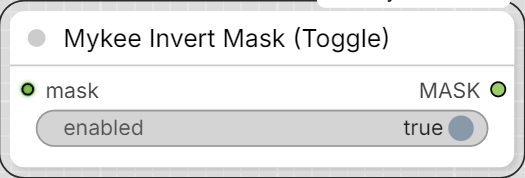

# Mykee Invert Mask (Toggle)

[← Back to the main README](../README.md)

  

An enhanced version of the base ComfyUI "InvertMask" node with an
`enabled` (On/Off) toggle:

- `mask` (MASK) - the input mask.
- `enabled` (BOOLEAN, default: on) - if enabled, the mask is passed
  through inverted (`1.0 - mask`), just like the plain InvertMask. If
  disabled, the input mask is passed through unchanged.
- The `enabled` widget can be turned into a socket via right-click
  ("Convert widget to input"), so it can be driven not just by hand but
  also from another (sub)graph's/subtree's BOOLEAN output.

The node id is `MykeeInvertMaskToggle`, and it appears under the
`Mykee/Mask` category as "Mykee Invert Mask (Toggle)" - so it doesn't
clash with the built-in ComfyUI "InvertMask" node.
