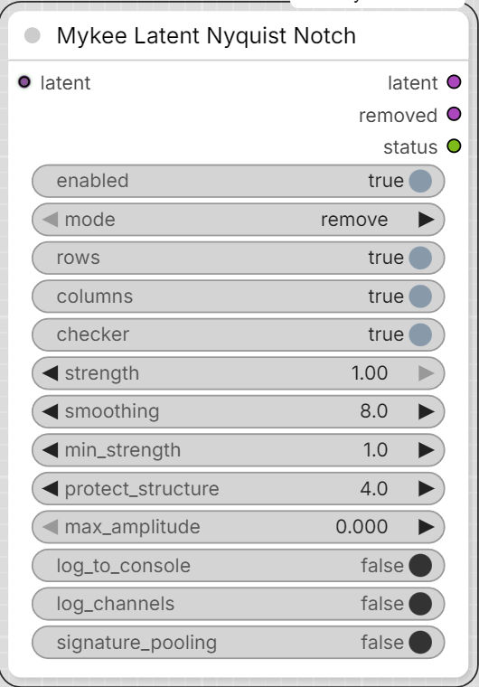

# Mykee Latent Nyquist Notch

[← Back to the main README](../README.md)  ·  Category: `Mykee/Latent`

<p align="center">
  
</p>


Removes the component of a **LATENT** that alternates every single latent
pixel (the Nyquist frequency), before the VAE decode. DiT models that
patchify the latent in 2x2 blocks (Flux / Chroma / Qwen Image ...) can leave
a faint 2-latent-pixel pattern behind; with an 8x VAE that is a 16 px stripe
or grid pattern in the decoded image, and it gets stronger at high
resolution (e.g. Chroma above 1024 px). The node is **experimental**: it was
written from measurements of decoded images, not of latents - run it once
with `mode = measure_only` first and read the status.

The idea of a Nyquist notch comes from
[ComfyUI-DeGrid](https://github.com/lunaaispace-eng/ComfyUI-DeGrid)
(Apache-2.0), which removes the 2 px grid of the Qwen/Wan VAEs from decoded
*images*. This node works on *latents* with a different, narrow-band method;
no code was copied.

Place it after every sampler pass that produces stripes, directly before the
next step that consumes the latent (`VAE Decode`, or the latent upscale of a
two-pass workflow). In a two-pass workflow (e.g. 1024 px base pass, 2x latent
upscale, second pass) use one node after each KSampler: the stripes of the
second, high-resolution pass are not touched by a node that sits only after
the first pass.

## Outputs

- **latent** - the cleaned latent.
- **removed** - what was subtracted (a LATENT; decode it only for curiosity).
- **status** - per image and per component: strength, parity lock, local
  envelope.

## Settings

- **enabled** - off = the latent passes through untouched.
- **mode** - `remove`, or `measure_only` (nothing changes, the status is
  still filled in).
- **rows / columns / checker** - which components to look for. `rows` is the
  part that alternates from one latent row to the next (horizontal stripes in
  the image), `columns` the vertical stripes, `checker` the grid.
- **strength** - how much of the measured component is subtracted (1 = all).
- **smoothing** - latent pixels over which the local amplitude is averaged
  (default 8 = 64 px in the image). Larger = narrower band, follows a drifting
  pattern less closely; smaller = follows it more closely but touches more
  real fine detail.
- **min_strength** - a component is only removed when its amplitude is this
  many times larger than the same measurement at neighbouring frequencies
  (about 1 for noise or no pattern). Below it that component is left alone.
  Default 1.0 (= always remove). The strength value is a global median and
  understates patterns that are present only in parts of a large latent: on a
  256x256 latent (2048 px image) it read only 1.3-1.4x although removal
  clearly reduced the stripes, so a threshold of 2 or more would have
  skipped it.
- **protect_structure** - cells whose local amplitude is this many times above
  the typical one are treated as real fine structure (fences, mesh, hard
  edges) and excluded; 0 = off.
- **max_amplitude** - largest correction per latent value; 0 = automatic
  (3 x the median amplitude).
- **log_to_console** - also print the status to the console.
- **log_channels** - diagnostics only, does not change the result. For every
  processed component the status also lists the signed local amplitude of each
  latent channel (x1000) averaged over the whole latent, both edge bands and
  the centre, plus the cosine similarity between these vectors. Cosines close
  to +1 between the edge bands and the whole latent mean the stripe has a
  stable per-channel pattern.
- **signature_pooling** - off by default. The stripe of one component usually
  appears in the latent channels with a fixed, signed pattern. When this is on,
  that pattern is estimated from the whole latent (channel means), the local
  per-channel amplitude is projected onto it, and one amplitude field is
  estimated from all channels together and written back through the pattern.
  Compared with the per-channel estimate this removes less noise and fine
  detail for the same `smoothing`, so a smaller `smoothing` (2-3) can be used
  with less loss of detail. It never removes more than the per-channel
  estimate: whatever does not fit the pattern stays in the latent. The auto
  limit of `max_amplitude` is replaced by 8x the rms of the pooled amplitude
  (or by `max_amplitude` when it is set). The status line shows how much of the
  amplitude energy the pooled estimate keeps; a low value means the stripe
  does not follow a single channel pattern.

## Reading the status

```
rows (horizontal stripes): strength 31.0x, parity-locked 0.0120, local envelope 0.0172 rms (1.3% of latent std) - removed
```

- **strength** - how clearly the pattern stands out. Around 1x there is no
  pattern. On small latents (e.g. 128x128) the stripes this node is meant for
  read around 3x or higher; on large latents patchy stripes can read as low
  as 1.3x and still be removed (see `min_strength`).
- **parity-locked** - amplitude when the pattern has a fixed phase over the
  whole latent. **local envelope** - amplitude measured locally. If the
  envelope is much larger than the parity-locked value, the phase drifts
  (the sign flips along the image) - the node follows that.
- If all components say "left untouched" with a raised `min_strength`, lower
  it to 1.0 and compare the result before concluding that the stripes do not
  come from a latent Nyquist pattern.
