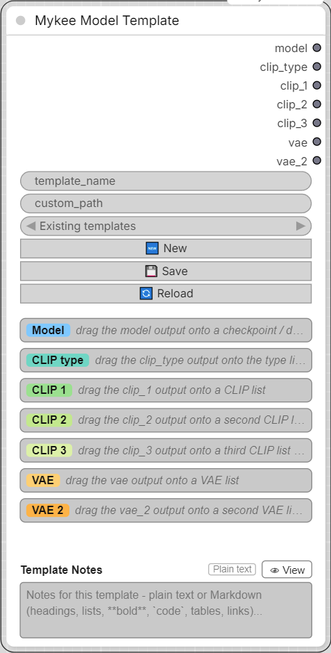

# Mykee Model Template

[← Back to the main README](../README.md)  ·  Category: `Mykee/Utils`

<p align="center">
  
</p>


Remembers which CLIP / VAE files (and which CLIP type) belong to which
model, so you don't have to keep that in your head. The node has seven
outputs - **model**, **clip_type**, **clip_1**, **clip_2**, **clip_3**,
**vae** and **vae_2** (for models that need two VAEs) - and you drag each one
onto the file-list (combo) widget of a loader node: `ckpt_name` of a
checkpoint loader, `unet_name` of a diffusion-model loader,
`clip_name` / `clip_name1..3` of the CLIP loaders, `type` of a CLIP
loader (for **clip_type**: stable_diffusion, flux, sd3, ...), `vae_name` of a VAE
loader. The output then takes over that widget's type (like a Primitive
node), the node's panel shows the loader's own file list as a dropdown,
and whatever is selected there is what the loader receives. Only the
outputs you actually need have to be connected - a single CLIP, two or
three, or none at all.

Templates are one small JSON file each, with the selection of the
**connected** outputs:

```json
{"version": 1, "model": "sdxl/mymodel.safetensors", "clip_type": "stable_diffusion", "clip_1": "clip_l.safetensors", "vae": "sdxl_vae.safetensors"}
```

Template Notes
--------------

At the bottom of the node there is a **Template Notes** field for a
description of the template (what the model needs, recommended
settings, links, ...). It takes plain text or Markdown, like a `README.md`:

- Text that uses Markdown (headings, lists, tables, `**bold**`, `` `code` ``,
  code blocks, quotes, task lists, `[links](https://...)`) is shown
  **formatted**; anything else is shown as plain text. The small tag in the
  header tells which one was detected.
- Click **✏ Edit** (or double-click the text) to edit; **👁 View** (or
  leaving the field) switches back. An empty field opens in edit mode.
- The field grows and shrinks with the text, both while typing and when a
  workflow or template is loaded. Very long notes scroll inside the box.
- The notes are saved in the template JSON as a `"notes"` string and stored
  in the workflow. Newlines, quotes, backslashes and accented characters
  are JSON-escaped; files are always written and read as UTF-8 (a file
  re-saved in cp1250 by an editor is still read correctly).
- Loading a template always replaces the notes: with the template's notes,
  or with an empty field if it has none. A template can be saved with notes
  only, even if no output is connected.
- Notes never reach the backend, so editing them does not re-run the node.

```json
{"version": 1, "model": "sdxl/mymodel.safetensors", "vae": "sdxl_vae.safetensors", "notes": "# My model\n\n- CFG 5-7\n- use **euler**"}
```

Storage location:

- By default, `ComfyUI/user/default/Model templates/`.
- If `custom_path` is filled in, that folder is used instead (created if
  it doesn't exist yet).

Loading a template is careful about what it touches. An entry is applied
only if **its output is connected AND the file name is in the list of the
widget it is connected to**. Everything else is left exactly as it is:

- model + VAE in the template, but no CLIP connected -> the model and the
  VAE are selected, nothing else changes.
- a file from the template is not installed on this machine -> that list
  keeps its current selection.
- an entry missing from the template (e.g. no `clip_3`) -> that output
  keeps its current selection.

A short message after every load tells what was applied and what was
skipped (and why). Folder separators don't matter when matching
(`sub\model.safetensors` from Windows matches `sub/model.safetensors`
on Linux), and a different upper/lower case is tolerated as a fallback.

Picker and buttons (same as in Mykee Prompt Template):

- **Existing templates** (dropdown) - picking an entry loads it
  immediately. There's no separate Load button.
- **🔄 Reload** - re-fetches the template list (at the current
  `custom_path`) and re-reads the connected file lists - useful after
  adding model files and refreshing the loaders.
- **🆕 New** - clears `template_name` for a fresh template. The current
  selections stay, so a similar setup can be saved under a new name.
- **💾 Save** - writes the selection of the connected outputs under
  `template_name` (sanitized like in the Prompt Template node).

Notes:

- Each output only accepts combo (list) widgets. If an output drives
  several widgets, they must have identical lists.
- If a remembered file is no longer in the list (e.g. after loading an old
  workflow on another machine), the dropdown shows it marked with `⚠`
  instead of silently switching to another file.
- The panel's **↻** button next to a list re-reads that list.

Inputs:

- **template_name** (STRING) - name of the template; also its file name.
- **custom_path** (STRING) - optional folder override, see above.

Outputs (all `*`, they take the type of the widget they are connected to):

- **model**, **clip_type**, **clip_1**, **clip_2**, **clip_3**, **vae**, **vae_2** - the
  selected entries (nothing for outputs that are not connected).
