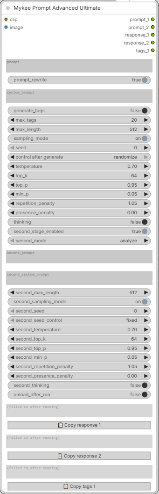

# Mykee Prompt Advanced Ultimate

[← Back to the main README](../README.md)  ·  Category: `Mykee/Prompt`

  

A merged, **two-stage** version of Mykee Prompt Advanced and the Prompt
Modifier, built around one idea: **first write out a detailed description,
then answer a question about it / edit it - from the text alone.**

Why two stages? On non-thinking VL models a single "describe the image
*and* answer this question about it" instruction is unreliable: the model
commits to a quick, statistically typical answer before it has actually
looked at the fine details, and there is no hidden reasoning to catch the
mistake afterwards - the generated tokens *are* the only reasoning. Splitting
the job forces stage 1 to write the visual evidence down as real, visible
text; stage 2 then works purely from that text (it never sees the image
again), where a "check for consistency" instruction has something concrete
to check against.

## Stage 1 - description

- **Image connected**: a full, highly detailed prose description. If
  `prompt` contains a specific question or focus, the default system prompt
  tells the model to explicitly confirm *or rule out* every detail relevant
  to it - including saying clearly when something is **not** present, which
  a plain "describe the image" instruction tends to skip.
- **No image**: paraphrases `prompt` back (like Mykee Prompt Advanced).

## Stage 2 - answer / edit (always text-only)

Runs only if **second_stage_enabled** is ON (default) **and**
`second_prompt` is not empty. Otherwise it is skipped and `response_2`
simply mirrors `response_1`.

The model receives stage 1's result as plain text plus `second_prompt`,
and works strictly from that. **second_mode** picks what that means:

- **analyze** (default) - `second_prompt` is a *question* about stage 1's
  result ("RESPONSE 1"); stage 2 answers it.
- **edit** - `second_prompt` is an *edit instruction*; stage 2 rewrites the
  stage-1 text accordingly, the same way as Prompt Modifier does (a short
  analysis/plan first, then only the part after the `===FINAL===` marker is
  used as `response_2`).

The built-in stage-2 prompt follows `second_mode`. If you write your own
`second_system_prompt`, refer to the labels the mode uses: "RESPONSE 1"
(analyze) or "PROMPT" / "EDIT INSTRUCTION" (edit).

Both stages share the same `clip`, loaded once. Each stage has its **own
independent controls**, because a long, varied description and a short,
deterministic answer usually want different settings.

## Tags

With **generate_tags** ON, stage 1 is additionally asked for an
e621-style comma-separated tag list below a `===TAGS===` marker line,
after the description. **max_tags** (2-100, default 20) limits the length;
the model is told not to pad the list with "absence" tags ("no bra",
"no jewelry", ...) just to reach that count. `response_1` always keeps the
full raw text (description + marker + tags); the tag list is also split out
into its own `tags_1` output. (If you use a custom `system_prompt` without
the marker, `tags_1` stays empty.)

## Inputs

- **clip, image, video, audio** - as in Mykee Prompt Advanced (Gemma 4 gets
  its native chat template, video and audio; see
  [Mykee Prompt Advanced](prompt-advanced.md#gemma-4-video-and-audio)). The
  media is used by stage 1 only.
- **prompt** - stage 1's user turn (a question/focus/context in image mode;
  the text to paraphrase in text-only mode).
- **prompt_rewrite** - master switch. OFF: no model calls for either
  stage, everything passes through, no VRAM load.
- **system_prompt** - stage 1's system prompt (empty = built-in default).
- **generate_tags, max_tags** - see above.
- **max_length, sampling_mode, seed, temperature, top_k, top_p, min_p,
  repetition_penalty, presence_penalty, thinking** - stage 1's generation
  controls (same meaning as in Mykee Prompt Advanced).
- **second_stage_enabled, second_mode, second_prompt,
  second_system_prompt** - stage 2 settings, see above.
- **second_max_length, second_sampling_mode, second_seed,
  second_seed_control, second_temperature, second_top_k, second_top_p,
  second_min_p, second_repetition_penalty, second_presence_penalty,
  second_thinking** - stage 2's own generation controls.
  **second_seed_control** (fixed / increment / decrement / randomize) is
  the node's own equivalent of ComfyUI's *control after generate*: after
  each run it updates `second_seed` for the next one.
- **thinking_budget**, **second_thinking_budget**, **template_mode**
  (optional) - extra tokens for each stage's thinking (default 1024 / 512)
  and the chat-template mode; see
  [Mykee Prompt Advanced](prompt-advanced.md#gemma-4-video-and-audio).
- **unload_after_run** - frees `clip` from VRAM once, after both stages
  have finished.

## Outputs

- **prompt_1** - stage 1's input prompt, unchanged.
- **prompt_2** - `second_prompt`, unchanged (whether or not stage 2 ran).
- **response_1** - stage 1's full, unsplit result (including the
  `===TAGS===` marker and tag list, if generated).
- **response_2** - stage 2's result, or a copy of `response_1` if stage 2
  was skipped.
- **tags_1** - only the tag list from `response_1`. Empty if
  `generate_tags` is off.
- **thinking_1**, **thinking_2** - the reasoning of stage 1 / stage 2 when
  their `thinking` toggle is on (empty otherwise). The reasoning never ends
  up in the responses.

`response_1`, `response_2`, `tags_1`, `thinking_1` and `thinking_2` are also shown in read-only text
boxes at the bottom of the node after each run, so you can check them
without wiring the outputs anywhere. Editing those boxes has no effect -
they are overwritten on the next run.
