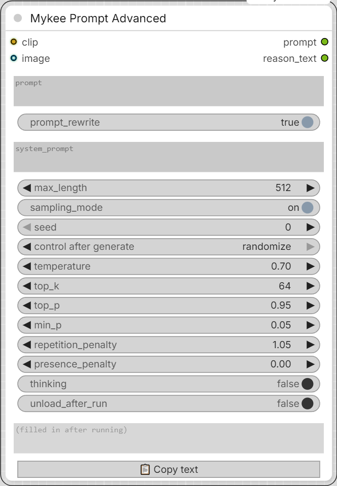

# Mykee Prompt Advanced

[← Back to the main README](../README.md)  ·  Category: `Mykee/Prompt`

  

A general-purpose chat/instruction node for any text-capable CLIP loader
(Qwen3, Gemma, ...). It uses the same public API as ComfyUI's own built-in
"Generate Text" node, but adds an **editable system prompt**, an optional
**image input** for vision-language (VL) models, and a clean prompt
passthrough output.

**Two modes:**

- **Text-only** (no image connected): by default the model paraphrases
  your image-generation prompt back in its own words - handy for catching
  wording the model reads differently than you intended. If you fill in
  `system_prompt`, the node runs any other single-turn instruction instead.
- **Image mode** (image connected + a VL-capable clip): the model describes
  the image in full, plain, uncensored detail - image type/style, setting,
  every person (face, hair, pose), clothing, any nudity exactly as shown,
  camera/lighting, and mood - as flowing English prose. If `prompt` also
  contains text (a context or a comma-separated list of tags), those words
  are worked into the description, and where they conflict with what is
  visible, the prompt wins (e.g. the prompt says "night" -> it is described
  as night even if the image looks like day). If the connected clip cannot
  read images, a toast notification says so and the node falls back to
  text-only mode.

**Important:** the node needs a *generation-capable* chat/VL model. An
encoder with no LM head wired up in ComfyUI - e.g. Krea 2's own Qwen3-VL
conditioning encoder - cannot be used here; load a separate chat/VL model
for this node instead (see
[ComfyUI issue #14388](https://github.com/Comfy-Org/ComfyUI/issues/14388)).

## Inputs

- **clip** - the text/VL model. For image mode it must be a VL model.
- **prompt** - the user turn. In text-only mode the text is sent to the
  model wrapped in triple quotes (`"""..."""`), so it is treated as the
  text to describe and never as an instruction to carry out (it does not
  need quotes of its own). In image mode it is optional context / a
  question and is sent as written.
- **prompt_rewrite** - on by default. Turn it OFF to skip the model call
  completely (no VRAM load at all): `prompt` just passes through to both
  outputs, so the node works as a plain text field while the rest of the
  graph stays wired.
- **system_prompt** - leave empty for the built-in default (paraphrase /
  describe the image); fill in to override. You may write `{max_length}`
  in it, and it is replaced with the current token limit.
- **max_length** - maximum tokens the model may generate for its answer
  (default 512). The built-in prompts tell the model this budget so it
  finishes with a complete sentence instead of being cut off. The limit
  applies to the *answer only* - the length of the prompt itself is added
  on top automatically.
- **sampling_mode** - ON: sampling with the settings below (varied
  results, reroll with a new seed). OFF: greedy decoding - always the most
  likely token, fully deterministic; the knobs below and the seed are
  ignored.
- **seed, temperature, top_k, top_p, min_p, repetition_penalty,
  presence_penalty** - the usual sampling controls, with the same
  defaults/ranges as ComfyUI's own "Generate Text" node.
- **thinking** - lets a thinking-capable model (Gemma 4, Qwen3.5, ...)
  reason first. The reasoning is never mixed into `reason_text`; it goes to
  the **thinking** output.
- **unload_after_run** - frees this clip from VRAM right after generating,
  without touching any other model loaded in the workflow (e.g. your
  diffusion model). It is reloaded automatically next time. Useful for
  large chat models you only need briefly.
- **image** (optional) - switches the node into image-description mode.
- **video**, **audio** (optional, Gemma 4) - see below.

## Outputs

- **prompt** - the original prompt, unchanged, so the node can sit inline
  before a text encoder without breaking the chain.
- **reason_text** - the model's response. It is also shown in a read-only
  text box at the bottom of the node after each run.
- **thinking** - the model's reasoning text (empty if there was none), also
  shown in its own read-only box.

## Gemma 4, video and audio

The node detects a **Gemma 4** clip and then lets ComfyUI's own Gemma 4
tokenizer build the whole chat template - system prompt, the `thinking`
flag and the image / video / audio tokens - exactly like ComfyUI's built-in
"Generate Text" node does. (Earlier versions always hand-built a Qwen-style
`<|im_start|>` chat for every model; Gemma 4 cannot read that, so it never
saw the image and answered with nonsense.) Every other model now goes the
same way by default, see **template_mode** below.

- **thinking_budget** (optional, default 1024) - extra tokens added on top
  of `max_length` while `thinking` is on. The reasoning is generated before
  the answer and uses the same token budget, so a long thought could leave
  no room for the answer; this gives the thinking its own room. No effect
  with `thinking` off. Raise it if the answer comes back empty or cut off.
- **template_mode** (optional) - `auto` (default): ComfyUI's own tokenizer
  builds the model's chat template, so the node follows whatever templates
  ComfyUI knows (Gemma 4, Qwen3-VL, Qwen3.5, ...); if that fails for the
  connected clip, the node falls back to the old Qwen ChatML text.
  `native`: ComfyUI's template only, errors are shown. `legacy_chatml`: the
  old hand-built Qwen-style `<|im_start|>` text (image only) - use it if a
  model misbehaves with the native template. Gemma 4 always uses the native
  template.

- **video** (optional, Gemma 4) - video frames as an IMAGE batch. Assumed to
  be 24 FPS and sub-sampled to 1 FPS internally, like the built-in node.
  If both a video and an image are connected, the video is used.
- **audio** (optional, Gemma 4 variants with audio support, e.g. E2B/E4B) -
  the model hears the audio. Audio alone gets its own default prompt
  (speech quoted verbatim, music, sounds); together with an image / video
  the description gets an extra "what is heard" part. Very long audio may be
  cut off by the model.
- Media the connected clip cannot take (video/audio on a Qwen clip, image
  on a non-VL clip) is ignored with a toast, and the node falls back to
  text-only.
- **thinking** - with the `thinking` toggle on, the model's reasoning goes
  to the separate **thinking** output (and its own text box on the node)
  instead of being thrown away. It is filled in whenever the model produced
  a thinking block.

## Credits

The technique of inserting the image placeholder token by hand (needed
because a hand-built chat text skips the tokenizer's own template) follows
silveroxides' *Text Generate Qwen3.5 (System Prompt)* node in
[ComfyUI-UtilsCollection](https://github.com/silveroxides/ComfyUI-UtilsCollection).
The VRAM-unload technique follows SeanScripts'
[ComfyUI-Unload-Model](https://github.com/SeanScripts/ComfyUI-Unload-Model).
