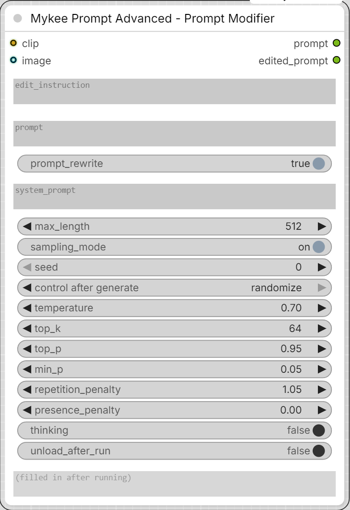

# Mykee Prompt Advanced - Prompt Modifier

[← Back to the main README](../README.md)  ·  Category: `Mykee/Prompt`

  

The "edit" sibling of **Mykee Prompt Advanced**. Instead of paraphrasing a
prompt or describing an image from scratch, it takes an **existing prompt
(or image)** plus a separate **edit_instruction**, and rewrites *only the
details the instruction addresses* - everything else (wording, structure,
language, length) stays as close to untouched as possible. It also
resolves contradictions the edit creates elsewhere: e.g. if the
instruction puts a piece of clothing back on, anything that only makes
sense with it off is fixed too, not left dangling.

**Two modes:**

- **Text-only** (no image): `prompt` is edited surgically according to
  `edit_instruction`, keeping its original form - tag list stays a tag
  list, prose stays prose, same language, same length. The model goes
  through the prompt unit by unit (every sentence, every tag): each is changed,
  removed (no longer true after the edit), added, or kept word for word; a trailing `Tags:` line is always returned, with tags
  that no longer hold removed and tags for new elements added. Its one-
  sentence ANALYSIS is stripped from the result; if the model runs out of
  `max_length` before reaching the result, the node reports that instead of
  returning the plan.
- **Image mode** (image + VL-capable clip): the model first works out
  internally exactly what the image shows, then writes a prose description
  of **that same scene with the edit applied**. The two-step approach is
  deliberate: a single "describe this image and also apply this edit"
  instruction proved unreliable at actually taking the edit into account.
  If `edit_instruction` is empty, the image is simply described as-is.
  Here `prompt` is optional extra context.

## Inputs

- **clip** - text/VL model (VL needed for image mode; must be
  generation-capable, see Mykee Prompt Advanced).
- **edit_instruction** - the change(s) to make, in plain language.
- **prompt** - the prompt to edit (text mode), or optional context (image
  mode).
- **prompt_rewrite** - OFF: no model call, no VRAM load; `prompt` passes
  through unchanged to both outputs.
- **system_prompt** - empty = built-in default (surgical edit / understand
  then re-describe with the edit applied). Fill in to override;
  `{max_length}` is replaced with the token limit.
- **max_length, sampling_mode, seed, temperature, top_k, top_p, min_p,
  repetition_penalty, presence_penalty, thinking, unload_after_run** - the
  same as in Mykee Prompt Advanced (same defaults).
- **edit_method** (optional, text mode only) - `patch` (default), `rewrite` or `classic`.
  With `patch` the node splits `prompt` into numbered sentences plus the tag
  list and asks the model only for a small JSON diff (which sentences to
  keep / rewrite / delete, which sentences to add, which tags to remove or
  add). The node itself applies the diff, so everything the model did not
  touch stays word for word and the `Tags:` line is always rebuilt. If the
  model returns unusable JSON twice, the node falls back to `rewrite` (the
  model rewrites the whole text). A custom `system_prompt` also uses
  `rewrite`. `rewrite` uses the unit-by-unit rules (the whole text is
  rewritten, the tag list is always returned). `classic` is the original
  first-version system prompt, kept verbatim, also a whole-text rewrite.
- **image** (optional) - switches the node into image-edit mode.
- **thinking_budget**, **template_mode** (optional) - as in
  [Mykee Prompt Advanced](prompt-advanced.md#gemma-4-video-and-audio).
- **video**, **audio** (optional, Gemma 4) - same idea as the image: the
  model's description of the video / audio with the edit applied. See
  [Mykee Prompt Advanced](prompt-advanced.md#gemma-4-video-and-audio).

## Outputs

- **prompt** - the original prompt, unchanged (so the node can sit inline
  in a chain).
- **edited_prompt** - the rewritten prompt / description. Also shown in a
  read-only text box on the node after each run.
- **analysis** - the model's short plan (the ANALYSIS line it writes before
  the result): what it understood and changed. Empty when the model call is
  skipped (`prompt_rewrite` off). If the model ran out of `max_length` while
  still planning, the unfinished plan is here, so you can see what happened.
  With `patch`, the analysis also lists every applied change (rewritten /
  removed / added sentences, removed / added tags, ignored tags that were
  not in the list, and how many sentences and tags were kept).
- **thinking** - the model's reasoning text when `thinking` is on (empty
  otherwise), also shown in its own read-only box. The reasoning never ends
  up in `edited_prompt`.
