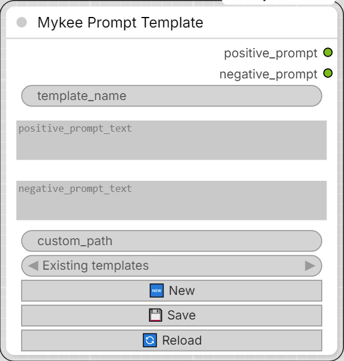

# Mykee Prompt Template

[← Back to the main README](../README.md)  ·  Category: `Mykee/Prompt`

  

A small prompt library node. `positive_prompt_text` and
`negative_prompt_text` are real, multiline STRING widgets - together
they're always what the node outputs, whatever you last typed or
loaded. "Load" / "Save" / "Reload" just move both of them to and from
disk together, one plain JSON file per template (mirroring how this
pack's StyleGAN vectors are each their own `.npy`/`.json` pair).

Storage location:

- By default, `ComfyUI/user/default/Prompt templates/`.
- If `custom_path` is filled in, that folder is used instead (created if
  it doesn't exist yet).

Each template file holds `{"prompt": "...", "negative_prompt": "..."}`.
Older files saved before the negative-prompt field existed
(`{"text": "..."}`) still load fine - as a positive prompt with an
empty negative prompt.

Picker and buttons:

- **Existing templates** (dropdown) - picking an entry loads it
  immediately, overwriting both `template_name` and the two prompt
  boxes. There's no separate Load button - selecting IS loading.
- **🔄 Reload** - re-fetches the list of templates on disk (at whatever
  `custom_path` is right now) into the "Existing templates" picker -
  useful after adding/renaming a file by hand, or after changing
  `custom_path`. Also runs automatically when the node is created.
- **🆕 New** - clears `template_name` and both prompt boxes, for
  starting a fresh template from blank instead of editing whatever was
  last loaded/typed.
- **💾 Save** - writes both prompt fields out together under
  `template_name`. The name is sanitized so the resulting file is valid
  on both Windows and Linux (forbidden characters stripped, trailing
  dots/spaces trimmed, Windows-reserved device names like `CON`/`COM1`
  prefixed with `_`) - if that changes the name, `template_name` is
  updated to match what was actually saved.

Unlike the StyleGAN Vector Save node, none of this needs the graph to
run - Save fires its REST call immediately, with no "armed"/queue step.

**Show Negative Prompt switch** (`show_negative_prompt`, off by default):
most prompts today don't use a negative prompt, and an empty box just
wastes space. While the switch is off, the negative prompt box is hidden
and the positive prompt box grows into the freed space; the
`negative_prompt` output is an empty string and Save stores an empty
negative prompt. Turning it on shows the negative box again (the two
boxes share the node's height). Loading a template that has a negative
prompt turns the switch on automatically, so it is never loaded
invisibly. Workflows saved before the switch existed come back with it
on if they contained a negative prompt.

Inputs:

- **template_name** (STRING) - name for this template; also its file
  name once saved. Only needed for Load/Save - the node runs fine with
  it empty.
- **positive_prompt_text** (STRING, multiline) - the positive prompt
  text.
- **negative_prompt_text** (STRING, multiline) - the negative prompt
  text.
- **custom_path** (STRING) - optional folder override, see above.
- **show_negative_prompt** (BOOLEAN, default off) - show the negative
  prompt box; see above.

Outputs:

- **positive_prompt** (STRING) - `positive_prompt_text`, unchanged.
- **negative_prompt** (STRING) - `negative_prompt_text`, unchanged -
  or an empty string while `show_negative_prompt` is off.
