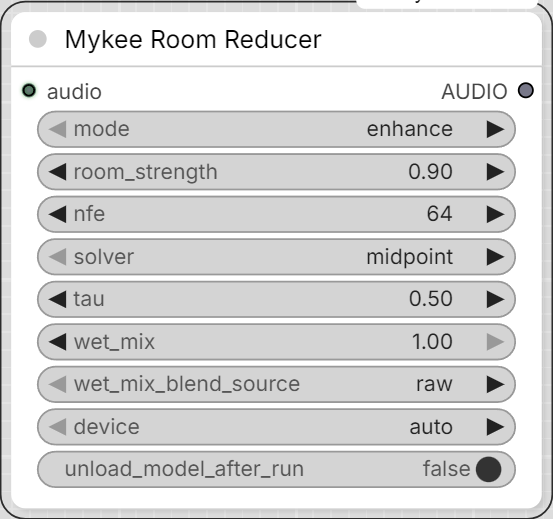

# Mykee Room Reducer

[← Back to the main README](../README.md)  ·  Category: `Mykee/Audio`

  

Reduces the "distant mic / roomy" character of a speech recording -
**not** the same problem as **Mykee Audio Dereverb** solves. WPE (that
node) is deliberately built to leave a guard interval right after the
direct sound untouched, so it only cancels the *late* reverb tail - it
does not touch early reflections or the room's own spectral coloration
(the "small/boxy/far" tonal signature a room stamps onto a distant or
off-axis recording even with zero audible echo). That coloration is
exactly what makes a clip sound "not into the mic" without there being
any audible slap or ring to point at - this node targets that instead.

Runs Resemble Enhance (https://github.com/resemble-ai/resemble-enhance,
`pip install resemble-enhance`) - a neural speech-enhancement model
trained specifically to map noisy/distant/reverberant recordings onto
studio-quality, close-mic-sounding output (a denoiser + a conditional-
flow-matching "enhancer" stage that also extends bandwidth). It is
complementary to WPE, not a replacement - chain them in either order;
WPE first tends to give the enhancer a cleaner signal to work with if
there's an audible late tail as well.

- **mode** - `enhance` (denoiser + CFM restoration - the one that
  actually reduces room coloration/distant-mic quality) or
  `denoise_only` (just strips background noise, lighter touch, won't
  do much for a roomy-but-quiet recording).
- **room_strength** (the model's own `lambd`, 0-1) - how hard the
  enhancer leans toward a close/dry/studio target vs. the original
  tonal character. Higher = treats the input as more distant/degraded.
  Only affects `enhance` mode.
- **nfe** / **solver** / **tau** - the enhancer's CFM ODE solver and how
  many steps it takes. Only affect `enhance` mode.
- **wet_mix** (0-1) - blends the processed signal back with the
  original (post-downmix, at the original sample rate). 1.0 = fully
  processed; lower it if the full effect sounds over-smoothed/
  artificial for your material.
- **wet_mix_blend_source** - what `wet_mix` blends *toward* when it's
  below 1.0. `raw` (default) blends toward the untouched input -
  simple, but since that still carries the original's room coloration/
  reverb, a low `wet_mix` can partly bring that back. `denoise_only`
  instead runs a quick denoiser-only pass of the same audio and blends
  toward that - still not as "dry" as the full enhance output, but
  doesn't reintroduce room coloration the way raw does, and is a good
  option if `enhance` alone sounds rougher/raspier than you'd like (see
  below). Only affects `enhance` mode; costs one extra (fast, non-ODE)
  model pass when it applies.
- **device** - `auto`/`cuda`/`cpu`.
- **unload_model_after_run** - frees Resemble Enhance from VRAM once
  the run finishes, via ComfyUI's own model manager. Off by default.

## Recommended settings

There's no official named preset list on the model's page - just the
default slider values in Resemble AI's own demo (their Hugging Face
Space), which is effectively the closest thing to an official
recommendation, and is what this node defaults to:

- **solver**: `midpoint` - their demo labels it "recommended".
- **nfe**: `64` - their demo's label: higher gives better quality but
  is slower (128 is the max).
- **tau**: `0.5` - their demo's label: higher can improve quality but
  can reduce stability/add artifacts.
- **room_strength / lambd**: their demo defaults this "off" (`0.1`) and
  only recommends turning it up (`0.9`) when the recording also has
  heavy *background noise* - not just room coloration. For a
  distant-but-otherwise-clean recording, keep this low (roughly
  `0.1`-`0.3`) so it doesn't over-push the audio toward an artificial
  "studio" sound.

Beyond that, it's trial and error on your own material - e.g. a
resemble-enhance GitHub issue (#64) has people trying combinations like
`nfe=128, tau=0.1` or `nfe=264, tau=0.0, solver=rk4` chasing extra
clarity, with mixed results. Use the values above as a starting point
and adjust by ear.

## A known `enhance`-mode trait: raspiness

The CFM restoration stage's bandwidth extension can "invent" plausible
but not-quite-right high-frequency detail, which can read as a rougher/
raspier voice quality than the same material run through `denoise_only`
alone - this isn't a bug, just a property of generative restoration.
If you notice this: try lowering `nfe`, `room_strength`, and/or `tau`
first (less aggressive restoration = less invented detail); if that's
still not clean enough but you still want some room-coloration
reduction, set `wet_mix_blend_source` to `denoise_only` and bring
`wet_mix` down from 1.0 - this blends the (rougher) enhance output back
toward a clean denoiser-only pass instead of the raw input, tamping
down the raspiness without reintroducing the room coloration/reverb
that blending toward raw would.

Only supports mono at a fixed 44100 Hz internally (like VoiceFixer in
**Mykee AI Voice Restore**) - stereo input is downmixed, and the output
is resampled back to the *original* input's sample rate. A batched
`AUDIO` input is processed per-item; results are re-padded with
trailing silence to a common length afterward. Needs a GPU for
reasonable speed (CPU is very slow, especially at higher `nfe`).

The node shows a KSampler-style progress bar while it runs. It tracks
both the 30 s audio chunks and the solver steps inside each chunk (plus
the extra denoise pass when `wet_mix_blend_source` is `denoise_only`),
and Cancel now takes effect mid-clip instead of only between batch items.

## Checkpoint location

Unlike this pack's other AI nodes (VoiceFixer, Seed-VC), this one's
~1GB checkpoint is left at Resemble Enhance's *own* default download
location (inside the installed `resemble_enhance` package folder,
under `model_repo/enhancer_stage2/`, fetched via `git clone` + Git LFS)
rather than redirected into `ComfyUI/models/`. The library resolves a
second, nested download (the denoiser submodule's weights) via a path
baked into the downloaded `hparams.yaml` itself - reimplementing that
redirection to a custom folder would mean also reverse-engineering that
inner path, with a real risk of silently loading an empty/untrained
denoiser if it's gotten wrong. Left at the library's own default, this
is guaranteed to match how the authors' own demo app uses it. Needs
`git` (and Git LFS) available on your system the first time this node
runs, and network access to huggingface.co.

## Windows installation notes

Plain `pip install resemble-enhance` **will fail** on Windows - it
pulls in `deepspeed==0.12.4`, and pip tries to build deepspeed's
`async_io` (AIO) op from source, which needs a Linux-only `libaio` and
always fails on Windows with `LINK : fatal error LNK1181: cannot open
input file 'aio.lib'`. This node never touches deepspeed's actual
training/distributed code - it only needs `import deepspeed` to
succeed (unavoidable, since it's imported transitively even on the
inference-only code path). Fix:

1. Install a **precompiled** Windows deepspeed wheel instead of letting
   pip build one - e.g.
   https://github.com/6Morpheus6/deepspeed-windows-wheels (Python
   3.9-3.12, no CUDA toolkit needed). Match your ComfyUI
   `python_embeded`'s Python version.
2. `pip install resemble-enhance --no-deps` - the `--no-deps` is
   **critical**: resemble-enhance's own requirements pin
   `torch==2.1.1`/`torchaudio==2.1.1`/`torchvision==0.16.1`/
   `numpy==1.26.2`/`gradio==4.8.0`, which would downgrade ComfyUI's own
   working torch/CUDA stack without it.
3. Manually install the handful of small, harmless deps it still needs
   that ComfyUI's environment doesn't already provide:
   `pip install celluloid==0.2.0 ptflops==0.7.1.2 resampy==0.4.2 omegaconf==2.3.0 "tabulate>=0.9.0"`
   (**not** `tabulate==0.8.10` as resemble-enhance's own pin says - a
   ComfyUI-provided pandas already requires `tabulate>=0.9.0`; the
   version only affects a startup-time log line, nothing functional).

Two more Windows-only quirks in the checkpoint/library itself, both
already worked around **inside this node** (nothing extra to install
for these):

- The downloaded checkpoint's `hparams.yaml` was saved on a Linux
  machine, so a couple of its (training-only, never read at inference)
  `Path`-typed fields got serialized as
  `!!python/object/apply:pathlib.PosixPath` YAML tags - which Python
  3.12+ refuses to even instantiate on Windows, crashing the very first
  model load with `cannot instantiate 'PosixPath' on your system`. This
  node aliases `pathlib.PosixPath` to `WindowsPath` for the duration of
  that one parse.
- `enhance` mode's CFM solver does `float(scipy.optimize.fsolve(...))`
  to turn a 1-element array into a Python float - fine on the
  `numpy==1.26.2` resemble-enhance itself pins, but numpy 2.x (what a
  ComfyUI environment installed with the `--no-deps` approach above
  almost certainly already provides) raises `only 0-dimensional arrays
  can be converted to Python scalars` instead. This node patches that
  one method in place with an equivalent, numpy-2.x-safe version.
