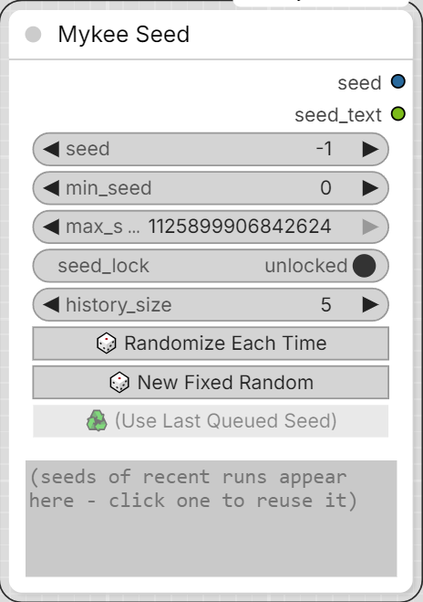

# Mykee Seed

[← Back to the main README](../README.md)  ·  Category: `Mykee/Utils`

  

A reworked version of the **Seed** node from
[rgthree-comfy](https://github.com/rgthree/rgthree-comfy) (MIT License,
see `THIRD_PARTY_NOTICES.md`). It works standalone - rgthree-comfy does
not need to be installed. It keeps the original's behavior (a seed that
is generated in the browser right before the workflow is queued, so the
real seed also ends up in the saved image metadata) and changes two
things:

- The random range is no longer hidden in the node's *Properties* panel:
  **min_seed** and **max_seed** are regular widgets on the node.
- A new **seed_lock** switch (see below).

The seed widget is called `seed_value` (label: "seed"). It is deliberately
not named `seed`, because ComfyUI would attach its own "control after
generate" combo to a widget with that exact name.

Special values of `seed_value`:

- **-1** - a new random seed (within `min_seed` .. `max_seed`, both
  inclusive) on every run. This is the default for a new node.
- **-2** / **-3** - the last used seed + 1 / - 1 (falls back to a random
  seed if there is no last seed yet). Type them in by hand.
- Any other value is used as is.

Buttons:

- **Randomize Each Time** - sets `seed_value` to -1.
- **New Fixed Random** - draws one random seed from the range right now
  and puts it into `seed_value`.
- **Use Last Queued Seed** - shows the seed used by the last run (only
  enabled if it differs from the current value); a click puts it into
  `seed_value`.

## seed_lock

- **unlocked** (default) - the classic behavior: with `seed_value` = -1,
  every run gets a new random seed and `seed_value` stays at -1. Keeping
  a seed you liked means pressing *Use Last Queued Seed* yourself.
- **locked** - whenever a seed is generated from a special value (-1, -2,
  -3), it is written into `seed_value` right away. The seed is "locked"
  without pressing anything, and the following runs keep using it. To get
  a new one, press *Randomize Each Time* (or type -1), which then locks
  the next generated seed again. A seed you typed in yourself is never
  touched.

## Seed history

A read-only text box at the bottom of the node lists the seeds of the most
recent runs, **newest on top**. Once the list is full (`history_size`
entries), the oldest one drops off. A seed that is used again (e.g. while
seed_lock keeps the same one) moves to the top instead of being listed
twice, so the list always shows distinct seeds.

**Click a line** to put that seed into `seed_value`. (Selecting text with
the mouse, e.g. to copy a seed, does not count as a click.)

The box exists only in the browser - it is never sent to the server, so it
cannot make the node or anything downstream re-run. The list itself is
stored in the node's properties (`mykee_seed_history`), so it survives a
page reload and is saved with the workflow (and therefore also ends up in
the workflow metadata of saved images). Lowering `history_size` trims the
list immediately.

Notes:

- With seed_lock **on**, *Run (x N)* / batch count uses the same seed for
  all N runs (the first run generates and locks it) - ComfyUI will
  usually skip the repeated runs because nothing changed. Use it
  **off** for batches of different seeds.
- A muted or bypassed Mykee Seed node is ignored. Nodes inside subgraphs
  are supported.
- If a special seed reaches the server anyway (an API call passing -1
  without the ComfyUI frontend), the server generates one from the
  min/max range and writes it into the prompt/metadata; `seed_lock` only
  works from the ComfyUI frontend.

Inputs:

- **seed_value** (INT) - see above.
- **min_seed** (INT, default 0) - lower bound of the random range.
- **max_seed** (INT, default 1125899906842624) - upper bound of the
  random range. If min is larger than max, the two are swapped.
- **seed_lock** (BOOLEAN, default off) - see above.
- **history_size** (INT, 1-50, default 5) - how many recent seeds the
  history box keeps.

Outputs:

- **seed** (INT) - the seed to use for this run.
- **seed_text** (STRING) - the same seed as text, e.g. for file names,
  so it does not need a separate INT-to-text conversion.
