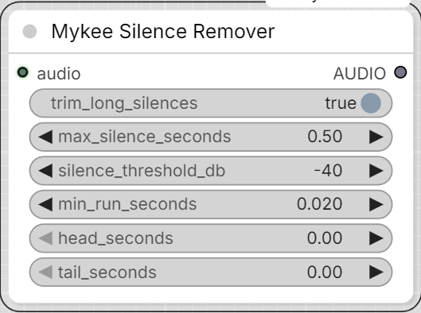

# Mykee Silence Remover

[← Back to the main README](../README.md)  ·  Category: `Mykee/Audio`

  

Caps long silent gaps inside an `AUDIO` clip down to a set maximum
length, and optionally pads fresh silence onto the start/end. Useful for
cleaning up dead air from any source, not just this pack's own TTS
nodes - a generated take with an overlong pause, a recording with excess
room tone between phrases, etc.

- **trim_long_silences** - finds runs of near-silence (by RMS energy, on
  a channel-averaged envelope so stereo imaging is preserved) longer
  than **max_silence_seconds** and cuts each down to exactly that
  length. Shorter pauses are left completely untouched, and actual audio
  content is never trimmed.
- **silence_threshold_db** - how quiet (dBFS) counts as silence; lower
  (more negative) to only catch near-total silence, raise it to also
  catch quiet room tone/breath noise.
- **min_run_seconds** - the frame size used to detect silence; smaller
  catches shorter gaps but is more sensitive to brief dips (consonant
  stops, etc.).
- **head_seconds** / **tail_seconds** - seconds of silence padded onto
  the very start/end of the (possibly now-shorter) result, added *after*
  trimming.

A batched `AUDIO` input is processed per-item (each clip trimmed on its
own silence pattern); since trimming can leave clips at different
lengths, the batch is re-padded with trailing silence to a common length
afterward so it's still a valid single `AUDIO` output.
