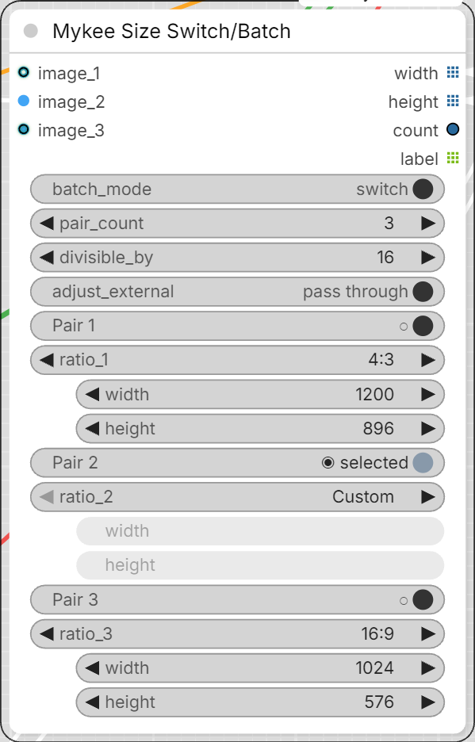

# Mykee Size Switch/Batch

[← Back to the main README](../README.md)  ·  Category: `Mykee/Image`

  

Up to 32 width/height pairs on one node, each pair with a selector. Works like
[Mykee Text Switch/Batch](text-switch-batch.md), but with sizes. Only one pair
is shown by default.

- **batch_mode** (top switch):
  - **switch** - each pair has a radio button; only the selected pair goes
    out.
  - **batch** - each pair has a checkbox; every ticked pair goes out, in
    order. **select all** / **clear all** buttons tick or untick every pair.
    The switch-mode selection and the batch-mode ticks are remembered
    separately, so flipping the mode loses neither.
- **pair_count** - number of pairs, 1-32 (default 1). The values of pairs you
  hide are kept, and come back when you raise the count again.

- **divisible_by** - `Off`, 8, 16, 32 or 64. Every number you type is rounded
  (up or down) to the nearest multiple of it, right in the field.
- **adjust_external** - what happens to values that arrive through a
  connection: **pass through** (default) uses them untouched, **adjust**
  rounds them to `divisible_by` and fits them to the ratio too.

Every pair is a block of four rows: the selector (**Pair N**), the aspect
ratio **ratio_N**, **width_N** and **height_N**. Width and height are normal number widgets, so each of them can
also be fed from outside: connect a link to the widget and the connected value
replaces the typed one (the widget is then greyed out). The selector still
decides whether the pair is used. The inputs are lazy: a pair that is not
selected is never evaluated.

**Image input:** every pair also has an optional **image_N** input. When an
image is connected, its size is used as the pair and the typed width / height
are greyed out. An image counts as an outside value, so **adjust_external**
decides whether it is passed through or rounded / fitted to the ratio. The
image is only read for its size, and only when its pair is selected.

**Aspect ratio** (`Custom`, 1:1, 16:9, 9:16, 2:1, 1:2, 3:2, 2:3, 4:3, 3:4, 5:4,
4:5, always width:height): with a ratio set, one side leads and the other is
calculated from it, then rounded to `divisible_by`, so only whole numbers come
out. The leading side is the one you edited last - or the connected one, if
only one side is connected. The calculated field updates as you type. Because
of the rounding the ratio is exact only when the numbers allow it (e.g. 16:9
with 64 gives 1920x1088, not 1920x1080).

Outputs:

- **width**, **height** - lists of the same length: in switch mode one value,
  in batch mode one per ticked pair. The nodes after them run once per pair
  (e.g. Empty Latent -> KSampler renders one image per size), and width and
  height stay matched.
- **count** - how many pairs went out.
- **label** - each pair as text, e.g. `1024x768` (handy for file names).

If no pair is selected (or none is ticked in batch mode), the outputs are
blocked, so nothing after the node runs.

Only the selected pairs are sent to the server, so editing a pair that is not
selected does not make anything re-run.
