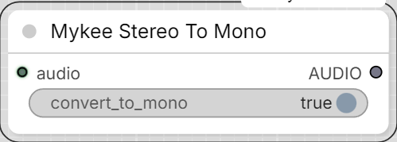

# Mykee Stereo To Mono

[← Back to the main README](../README.md)  ·  Category: `Mykee/Audio`

  

Simple channel-count normalizer: forces the `AUDIO` output to mono or
stereo regardless of whether the input already is mono or stereo.

- **convert_to_mono** OFF - output is stereo. A mono input is duplicated
  to both channels; a stereo input passes through unchanged.
- **convert_to_mono** ON - output is mono. A stereo input is downmixed
  (channel-averaged); a mono input passes through unchanged.
