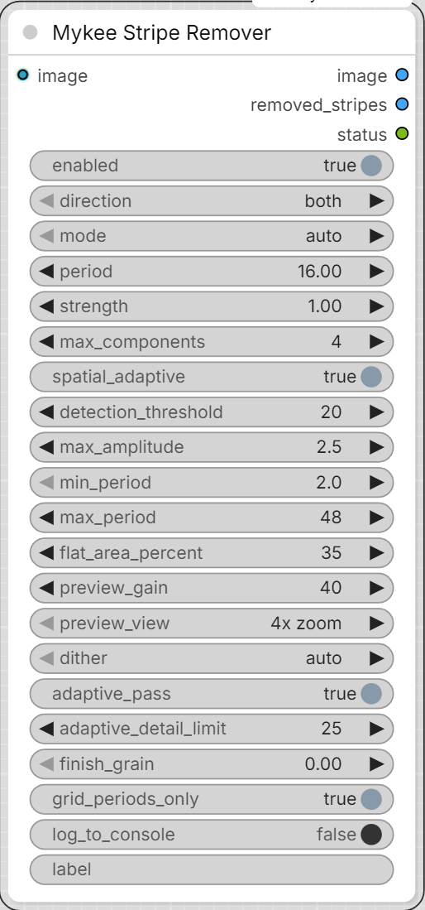

# Mykee Stripe Remover

[← Back to the main README](../README.md)  ·  Category: `Mykee/Image`

  

Removes faint, periodic **horizontal and/or vertical stripes** from an image.
Built for the banding that DiT image models (Chroma, Flux family, ...) can
show when they are run far above their training resolution: 8x VAE
downsampling x 2x2 patches = a **16 px grid**, so the stripes repeat every
16 px (plus harmonics: 8 px, 5.33 px ...). They are easiest to see in smooth
areas such as sky. This is **not** a VAE artifact, so VAE-specific filters
(e.g. 2 px grid removers for the Qwen / Wan VAEs) do not help here.

Nothing has to be tuned - the node measures the stripes from the image it
receives:

1. The smoothest part of the picture (sky, walls, smooth skin) is found
   automatically. Only that part is used for measuring, so real detail
   cannot be mistaken for stripes.
2. The row (column) signal of that area is searched, **tile by tile**
   (two segment lengths, 512 and 1024 rows),
   (up to 6 x-zones x 512-row segments), for a sharp periodic peak; the
   sharpest tile wins. (A whole-image signal is diluted by everything else
   that is smooth, e.g. sea ripples: on one test image the 16 px stripes of
   the sky had a local strength of 381 but only ~10 over the whole image.) The period is refined to sub-pixel accuracy, so it also works on
   images that were resized after generation (non-integer periods).
3. The period is refined to a fraction of a pixel with a coherent fold and
   snapped to an integer when it is that close (patch and VAE grids are
   integer periods; a 0.1 px error at 16 px would drift ~13 px over 2048
   rows and cancel the measurement).
4. One full period of the stripe pattern (all harmonics included) is folded
   out of the image with a matched high-pass filter - separately for each
   colour channel and for a grid of zones (x and y), because the stripe
   strength differs across the image and the phase of the stripes wanders
   slowly from top to bottom.
5. The pattern is subtracted.
6. **Adaptive pass** (see `adaptive_pass`): the stripes are then followed
   locally in amplitude and phase, which also removes them from textured
   areas such as skin. It is a tiny periodic pattern, so **no blur
   is applied to the image** and fine texture is not softened.

Up to `max_components` different periods are removed one after another per
direction. On Chroma/Flux images typically 4 px and 8 px (VAE decoder grid)
and 16 px and 32 px (DiT patch grid) show up; the strongest peak goes first.

Place it right after **VAE Decode** (before any sharpening or upscaling -
those amplify the stripes).

## Outputs

- **image** - the cleaned image.
- **removed_stripes** - exactly what was subtracted, amplified around grey
  (`preview_gain`). With the default `4x zoom` it shows a magnified centre
  crop where the stripes are clearly visible; the cleaned image is never
  cropped. A nearly flat grey preview means there was (almost) nothing to
  remove.
- **status** - the log of the current run as text (one line per message; a
  batch gets one block per image: `Image 1/4:`, `Image 2/4:` ...; the numbering
  starts again with every run), with a one-line header like
  `21:04:33  2048x2048, node 7, <label>`. There is no
  text box on the node; to read the log either connect this output to a text
  display node, or switch on `log_to_console` (off by default) and read it in
  the ComfyUI console window - every run is printed there as
  `[Mykee Stripe Remover] 21:04:33 ...`. The optional `label` input (e.g. a seed or
  a file-name prefix) is added to the header. Each direction ends
  with `strongest peak left X px N x (first found M x)`: the sharpest periodic
  peak that is still in the cleaned image, measured in float, so it also
  works where an 8-bit saved copy is too coarse to judge. Example:
  `horizontal: removed 16.00px (strength 310x, rms 0.42/255, fitted 16.07) - flat area used: 35%`.
  `fitted` appears when the measured period was snapped to an integer.

## Settings

- **enabled** - off = the image passes through untouched (A/B comparison).
- **direction** - `both` / `horizontal stripes` (lines running left-right,
  the pattern changes from row to row) / `vertical stripes`. `both`
  measures each direction separately and only removes what is really there.
- **mode / period** - `auto` measures the period. `manual` uses `period`
  (px) instead, e.g. `16`.
- **strength** - 1.0 = remove the measured stripes fully; lower = partial.
- **max_components** - how many different periods may be removed per
  direction (default 4).
- **spatial_adaptive** - measure the stripes in a grid of zones (up to 12 x 8)
  instead of one global profile. The grid is about 170 px wide and 256 px
  tall per cell (up to 12 x 8) - the stripe strength was measured to change
  by a factor of 5 within ~700 px at the top of a 2048 px image.
- **detection_threshold** - auto mode: how sharp a periodic peak must be
  (peaks at the known grid periods 16/k px - 16, 10.67, 8, 6.4, 5.33, 4.57,
  4 ... 2 px - only need 40% of this value; on a test image a real 16 px
  stripe had strength 37 and was missed at the plain threshold of 40)
  (compared with the noise around it) to count as stripes. The status line
  shows the measured strength, so you can see how far above the threshold
  your stripes are. Lower = more sensitive, higher = safer against false
  detections. If the status says "no periodic stripes found" although you
  can see stripes, lower it.
- **max_amplitude** - safety limit (rms, 1/255 units, default 2.5) for all
  removed patterns together. Real stripe artifacts measured 0.1-0.6 rms; more
  than this is treated as real content (e.g. corrugated metal) and left
  alone. (An existing workflow keeps its saved value - set it to 2.5 there.)
- **grid_periods_only** - on by default. Auto mode only accepts the periods
  the generators produce (VAE grid 2/4/8 px, DiT grid 16 px, harmonics 32/k
  px). In a test with a corrugated-metal picture the node had removed real
  40-60 px patterns (rms 6.6 levels, up to 32 levels) as 'stripes'; with this
  option those are left alone. A detected period is snapped to the exact
  grid period (4.03 -> 4.00 px). Off = any period (only for pictures that were
  resized after decoding). In a picture with no smooth area at all (detail of
  the flattest pixels above 10 levels) the relaxed grid threshold is not used.
- **min_period / max_period** - auto mode search range in px (default 2-48).
- **flat_area_percent** - the smoothest X% of the picture is used for
  measuring the stripes (default 35). Raise it if the image has very little
  smooth area. A picture without any truly flat area (e.g. a full-frame
  texture) is still measured: the stripes are locked to the pixel grid, the
  texture is not, so averaging over many texture pixels shows them.
- **preview_gain / preview_view** - only affect `removed_stripes`.
- **adaptive_pass** - on by default. The zone fit measures the stripes in
  the flat areas (sky) and applies the pattern everywhere. On skin the real
  stripes were measured to be about 4x stronger than in the sky and slightly
  shifted in phase, so they stayed. The adaptive pass multiplies the image
  with a complex carrier at each stripe frequency, averages it over about
  64 rows x 32 px (stripes are coherent over that area, random texture is
  not) and subtracts the local amplitude/phase it finds. A line is only
  removed as far as it stands out of its neighbouring frequencies, each line
  is capped at 1.5/255, the total at 3/255 per pixel, and the pass fades out
  around strong detail/edges. It only touches the harmonics of the periods
  that the measurement found, and only periods up to 24 px. Needs an image of
  at least 256 x 128 px. It works on a high-passed copy of the image: the
  image mean would otherwise leak through the pooling for periods that are
  not exactly 16/k px (a measured 16.07 px produced fake stripes of about
  1 level in v5). Real periodic structure (brickwork, fences, hard edges: a
  line amplitude of many levels) is excluded from the averaging (cells above
  about 3 levels get ~0 weight before the smoothing) and the correction in a
  cell never exceeds what that cell itself measures (v20). Before, such
  structure leaked into smooth areas next to it: a synthetic test gave
  +1.0 levels of fake 16 px stripes on a plain strip between two brick-like
  blocks, and 20% of the real structure was removed; v20 leaves both
  untouched. Off = zone fit only.
- **adaptive_detail_limit** - adaptive pass only (default 25). Local detail
  strength, in 1/255 levels, at which the pass fades out. Higher = more
  stripe removal from textured areas (skin), but closer to strong edges.
  Measured on a 2048 px test image: 15 -> thigh stripe 1.42 -> 0.60 levels,
  25 -> 0.48, 40 -> 0.46 but with the correction concentrating on edges
  (rms near strong edges 0.48 vs 0.25 elsewhere).
- **finish_grain** - 0 = off (default). Soft luminance grain, rms in 1/255
  levels, added after the stripe removal **only on smooth areas**. It does
  not remove stripes; it hides the faint leftovers (a few hundredths of a
  level) where nothing else masks them, e.g. in the sky. The weight follows
  the local detail: on the 2048 px test image ~0.93-1.0 in the sky, ~0.2-0.35
  on smooth skin, ~0 on cloth, hem and face. Start with 0.5-1.0. A blur is
  deliberately not used: a 1 px blur would cut the 4 px leftovers but would
  soften every fine detail, and it does almost nothing to the 16 px stripes
  (x0.93 at sigma 1 px).
- **dither** - `auto` / `on` / `off`. Adds +-0.5/255 white noise to the
  cleaned image. If the input is an **8-bit picture** (e.g. Load Image),
  its values are already whole numbers; subtracting a stripe pattern of
  less than 1/255 and saving to 8 bit (ComfyUI truncates) turns that
  pattern into a *new* 1-level stripe pattern in smooth areas - measured to
  make some regions worse than the unprocessed picture. The noise breaks
  that correlation. `auto` switches it on only when the input is detected
  as 8-bit; a fresh VAE Decode output is float and does not need it.

## Notes

- The measurement needs some smooth area. With a picture that is almost
  all texture the node says so in the status line and leaves the image
  alone.
- Stripes that are sub-LSB in a finished 8-bit file can only be removed
  with `dither` on (see above); the best place for the node is directly
  after VAE Decode, where the image is still floating point.
- Batches are processed image by image, each with its own measurement.
