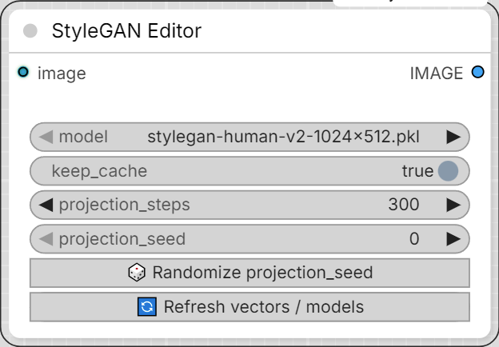

# Mykee StyleGAN Editor

[← Back to the main README](../README.md)  ·  Category: `Mykee/StyleGAN`

  

Same idea as Image Generation, but edits an existing photo instead of
generating from a seed - the "GAN inversion + latent editing" technique
(project a real photo into W space, nudge it along your saved direction
vectors, re-synthesize). Same vector sliders, same refresh button, same
`facegen_vectors/` source - just a different starting point than a seed.

- **image** - the photo to edit.
- **model** - must be the same generator your vectors were built for.
- **keep_cache** - on by default. Projecting a photo into W space is the
  slow part (same GAN-inversion algorithm as the Vector Preparation node's
  `image` mode); once it's done for a given image/model/projection_steps/
  projection_seed combination, tweaking the vector sliders and re-running
  reuses that projection instead of redoing it - only the (cheap) vector
  math + re-synthesis happens again. Change the image, model, or
  projection settings (or turn this off) to force a fresh projection.
- **projection_steps** / **projection_seed** (with its own
  **🎲 Randomize projection_seed** button) - same meaning as on the Vector
  Preparation node: more steps = closer match to the photo, slower; the
  seed makes the projection reproducible.
- No **truncation** setting here (unlike Image Generation) -
  `truncation_psi` only affects `G.mapping()`'s seed→W step, which this
  node never calls; it starts from the photo's own projected W instead.
- One slider per file in `facegen_vectors/`, exactly like Image
  Generation, via the same **🔄 Refresh vectors / models** button.
- Output: **IMAGE**.
- Quality caveat: GAN inversion is lossy - backgrounds, jewelry, unusual
  hairstyles, or extreme angles often shift slightly just from the
  projection step, before any vector is even applied. Works best on
  FFHQ-style photos (front-facing, centered, similar framing to the
  training data), same as the Vector Preparation node's `image` mode.
