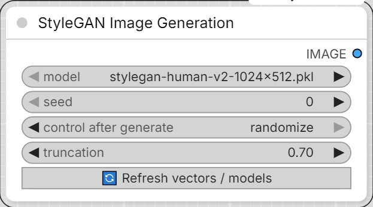

# Mykee StyleGAN Image Generation

[← Back to the main README](../README.md)  ·  Category: `Mykee/StyleGAN`

  

(Internally still `MykeeStyleGANFaceGenerator` / keyed around "face" since
this pack's vectors are built for faces - but any StyleGAN2/3 generator
works the same way regardless of what it was trained to produce.)

- **model** - a `.pkl` from `models/stylegan`.
- **seed** / **truncation** - same meaning as in your Gradio app
  (`truncation_psi`).
- One slider per file in `facegen_vectors/` is added automatically, using
  that vector's own `min`/`max`/`step`. 0 = neutral.
- **🔄 Refresh vectors / models** re-scans both `models/stylegan`
  (models) and `facegen_vectors` (vectors + their current JSON params) and
  rebuilds the sliders - no ComfyUI restart needed after adding or
  re-saving a vector. Existing slider values are kept where the vector
  still exists.
- Output: **IMAGE**.
