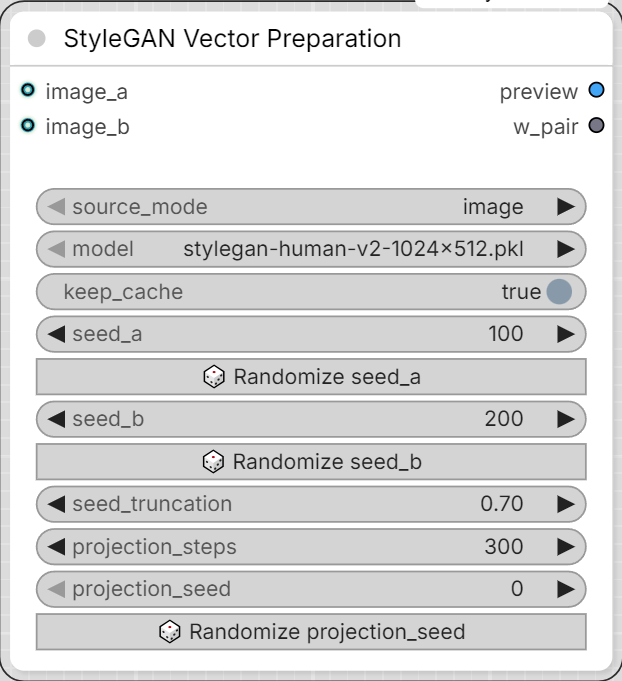

# Mykee StyleGAN Vector Preparation

[← Back to the main README](../README.md)  ·  Category: `Mykee/StyleGAN`

  

Builds the two W-space extremes of a new vector and previews them -
**nothing is ever written to disk by this node.** Re-roll seeds or try
different photos as many times as you like; saving only happens in the
[Save node](stylegan-vector-save.md), and only once you connect this node's `w_pair` output

- **keep_cache** - on by default. While on, re-running this node just
  replays its last result instantly instead of recomputing - this is
  separate from (and more reliable than) ComfyUI's own graph caching,
  which some upstream image-source nodes defeat by always reporting
  "changed" even when the image content is identical, forcing a full
  (slow) re-projection on every single queue - e.g. just from clicking
  the unrelated "Save" (JSON-only) button on the Vector Save node and
  then queuing again. Turn it off to force a genuinely fresh computation
  (new seeds, new photos), then back on once you like the result and
  just want repeated queues to reuse it.
into it.

- **source_mode** - `image` or `seed`, picks how `w_a`/`w_b` are produced:
  - `image` - **image_a** / **image_b** (two extremes, e.g. a short-hair
    photo and a long-hair photo) get GAN-inverted into W space (latent
    optimization against a VGG16 feature loss, the same algorithm as
    NVIDIA's official `projector.py`) - works from real photos, but takes
    anywhere from under a minute to a few minutes per image depending on
    `projection_steps` and your GPU, and the projection itself adds a bit
    of reconstruction noise to the result.
  - `seed` - **seed_a** / **seed_b** are mapped straight to W, no photos
    and no projection at all - this is the same trick the original
    `generate2.py`'s seed-pair vector builder used. Instant, and noise-free
    in the sense that there's no projection error, but the vector is only
    as clean as how well-matched the two seeds happen to be (everything
    that differs between the two faces bleeds into the vector, not just
    what you're after) - use the node's own **🎲 Randomize seed_a** /
    **🎲 Randomize seed_b** buttons to search for a well-matched pair (the
    same way the old Gradio UI's dice button did) and check the two faces
    in the preview output before committing to a name. These are plain
    buttons, not ComfyUI's built-in `control_after_generate` - two of
    those on the same node fight each other (their dropdowns end up
    mirroring one another), and worse, auto-randomizing after *every*
    queue - even in `image` mode where the seeds aren't used at all -
    silently changes the node's inputs each time, which defeats ComfyUI's
    caching and forces a full (slow) re-run just from clicking Save on the
    Vector Save node. The buttons only reroll when you click them.
  - Whichever mode, the two extremes only need to differ in the attribute
    you want - matching pose/background/framing/lighting between them
    (e.g. editing one photo into the other rather than picking two
    unrelated photos) gives a much cleaner vector either way.
- **model** - must be the same generator you intend to use the vector with.
- **seed_truncation** - only used in `seed` mode; `truncation_psi` for
  seed_a/seed_b's mapping (0.7 matches the original `generate2.py`).
- **projection_steps** - only used in `image` mode; GAN-inversion
  iterations per image. More = closer match, slower.
- **projection_seed** - only used in `image` mode; has its own
  **🎲 Randomize projection_seed** button. Seeds the optimization's
  internal noise (noise-buffer init + per-step latent jitter) via a
  dedicated Generator instead of PyTorch's unseeded global RNG, and also
  forces deterministic cuDNN/CUDA algorithms for the duration of the
  projection (restored to whatever they were before afterward, so this
  doesn't affect other nodes) - between those two, the exact same two
  images and the exact same parameters should reliably produce the exact
  same vector. This is best-effort, not an absolute guarantee: a handful
  of CUDA kernels have no deterministic implementation at all and quietly
  fall back to their normal (slightly run-to-run-variable) behavior
  rather than erroring. Change `projection_seed` to deliberately explore
  a different optimization path for the same images.
- Outputs: **preview** (IMAGE, the two reconstructed faces side by side)
  and **w_pair** - a graph-only connection (not a file, not JSON) carrying
  `w_a`/`w_b` plus the preview image; connect it to a Vector Save node.
- A small status line under the node title mirrors the build's progress
  while it runs.
