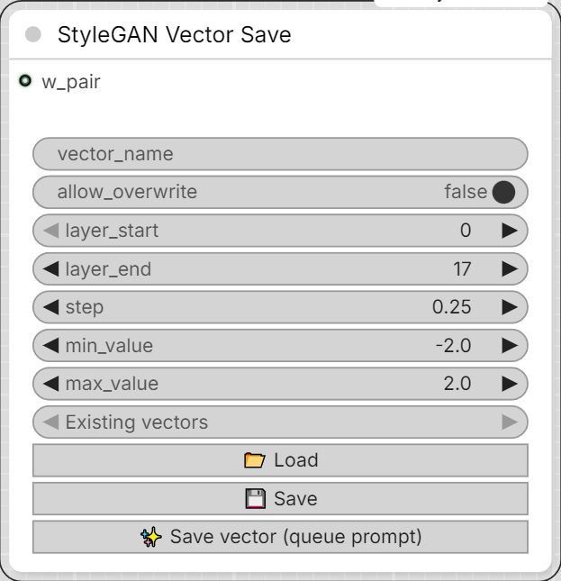

# Mykee StyleGAN Vector Save

[← Back to the main README](../README.md)  ·  Category: `Mykee/StyleGAN`

  

Takes a **w_pair** connection from a Vector Preparation node and, only when
`armed` is on, saves `diff = w_b - w_a` as `<vector_name>.npy` plus
`<vector_name>.json` (layer range, multiplier, min/max).

`armed` matters because this node is an `OUTPUT_NODE`, which ComfyUI runs
on **any** queue of a workflow it's part of - not just when you click this
node's own button. Without a gate, simply pressing the toolbar Run/Queue
button (e.g. to check the Preparation node's preview again) would silently
save every single time this node is wired up. `armed` defaults to off, the
`✨ Save vector` button turns it on right before queuing, and the node
turns it back off again the instant it actually runs (before doing
anything else) - so a later plain Run never re-saves on its own. You can
still flip `armed` on by hand if you specifically want one plain Run to
also save.

- **w_pair** - optional input, connect from a Vector Preparation node's
  `w_pair` output. Only needed to actually save a vector (the "✨ Save
  vector" button) - leave it disconnected entirely if you're only using
  this node's "Load"/"Save" to browse/edit existing vectors' JSON.
- **vector_name** - required for saving; also used by "Load"/"Save".
- **armed** - off by default; see above. Managed automatically by the
  "✨ Save vector" button.
- **allow_overwrite** - off by default. If `<vector_name>.npy` already
  exists, saving with this off raises an error instead of silently
  replacing it; turn it on (and confirm the browser prompt) to
  intentionally overwrite an existing vector. The "Save" button is
  unaffected by this - it only ever touches the `.json`, never the `.npy`.
- **layer_start / layer_end / step / min_value / max_value** - written into
  `<vector_name>.json` (see above).
- **Existing vectors** (dropdown, top of the node) - lists every vector
  currently on disk; picking one fills `vector_name`.
- **📂 Load** - loads `<vector_name>.json`'s current values into the
  fields above (pure REST call, doesn't need `w_pair`, `armed`, or the
  graph to run).
- **💾 Save** - writes the fields above into `<vector_name>.json`.
  Requires that `<vector_name>.npy` already exists.
- **✨ Save vector (queue prompt)** - the only normal way to actually save.
  Because `w_pair` only carries real data once the graph actually runs,
  this needs a real Queue Prompt rather than an instant button click: it
  turns `armed` on, then queues the workflow, so this node's Python
  FUNCTION saves `diff = w_b - w_a` as `<vector_name>.npy` (refusing to
  overwrite an existing one unless `allow_overwrite` is on) and writes
  `<vector_name>.json` from the current field values. The button also
  does a quick client-side check first - it warns if `w_pair` isn't
  connected, and warns/asks to confirm if `vector_name` already exists on
  disk. This node has no outputs - the preview is the Preparation node's
  job, and the result shows up in the status line below plus a toast.
- A small status line under the node title mirrors the save's progress.
