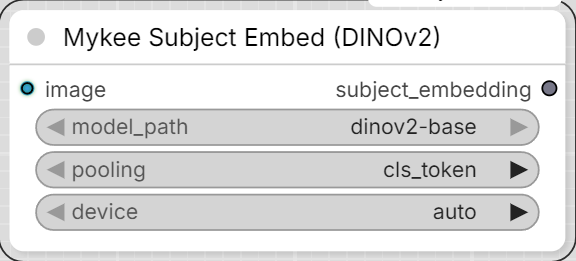

# Mykee Subject Embed (DINOv2)

[← Back to the main README](../README.md)  ·  Category: `Mykee/Character`

  

A 768-dim "subject" embedding from a full (not just face-cropped)
reference image - this is what captures body-shape/clothing consistency
where SFace only ever looks at the face.
