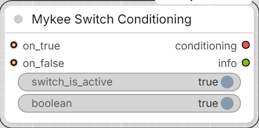

# Mykee Switch Conditioning

[← Back to the main README](../README.md)  ·  Category: `Mykee/Conditioning`

  

A rework of Crystian's ["Switch conditioning"](https://github.com/crystian/comfyui-crystools)
node from ComfyUI-Crystools, with more forgiving logic for the common
case where only one of the two branches is actually wired up. The
original treats `on_true`/`on_false` as required and always follows
`boolean` literally regardless of whether the input it points to is
connected - so leaving one branch unplugged while iterating on a graph
is a hard error, even though the obvious intent is "just use whichever
one is there".

**Important:** "disabling the switch" means turning OFF the
`switch_is_active` widget below, **not** using ComfyUI's own node
Bypass/Mute (right-click a node -> Mode) on this node itself - same
reasoning as [Mykee Image Switch](image-switch.md): a natively bypassed node's
Python code never runs at all, so it can't apply this node's logic.

- **switch_is_active** (BOOLEAN, default ON) - ON = normal switch mode
  (`boolean` picks between `on_true`/`on_false` when both are active);
  OFF = **bypass mode** (the switch is treated as inactive - `boolean`
  is ignored).
- **boolean** (BOOLEAN, default ON) - used only when `switch_is_active`
  is ON and both inputs are active: ON -> `on_true`, OFF -> `on_false`.
  Ignored when only one input is active, or when `switch_is_active` is
  OFF.
- **on_true** / **on_false** (CONDITIONING, optional).

Behavior:

- exactly one input active -> that one, **regardless of
  `switch_is_active` or `boolean`** - there's nothing to decide.
- both active, switch_is_active ON -> `boolean` picks `on_true` (ON) or
  `on_false` (OFF).
- both active, switch_is_active OFF (bypass) -> ambiguous (no selector
  is in effect), so the `conditioning` output is blocked via ComfyUI's
  `ExecutionBlocker` for anything downstream that needs it - no hard
  crash/traceback, other independent parts of the workflow keep
  running. Older ComfyUI versions without `ExecutionBlocker` fall back
  to a plain error instead.
- neither active -> same blocked-output behavior as above.

Outputs:

- **conditioning** (CONDITIONING).
- **info** (STRING) - a short human-readable note on which branch was
  used (or why the output was blocked), useful for debugging a graph.
  Unlike `conditioning`, this string is always a real value, even when
  `conditioning` is blocked.
