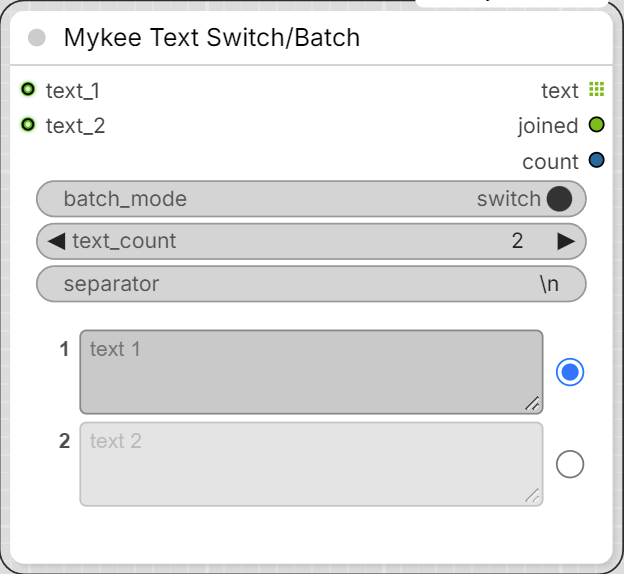

# Mykee Text Switch/Batch

[← Back to the main README](../README.md)  ·  Category: `Mykee/Prompt`

  

Up to 49 numbered text fields on one node, each with a selector at its end.

- **batch_mode** (top switch):
  - **switch** - each field has a radio button; only the selected text goes
    out (even if it is empty).
  - **batch** - each field has a checkbox; every ticked, **non-empty** text
    goes out, in field order. **select all** / **clear all** buttons tick or
    untick every field. The switch-mode selection and the batch-mode ticks
    are remembered separately, so flipping the mode loses neither.
- **text_count** - number of fields, 0-49 (default 2). Texts of fields you
  hide are kept, and come back when you raise the count again.
- **separator** - separator of the `joined` output (`\n` = new line,
  `\t` = tab).

Inputs: every field has its own optional **text_N** input socket. A
connected input replaces the field's typed text (the field is then shown
read-only), but its radio button / checkbox still decides whether it is
used. The inputs are lazy: an input whose field is not selected is never
evaluated.

Outputs:

- **text** - a list: in switch mode one text, in batch mode all selected
  texts. The nodes after it run once per text (e.g. CLIPTextEncode ->
  KSampler renders one image per text).
- **joined** - the same texts in one string, joined with `separator`.
- **count** - how many texts went out.

If nothing is selected (or every ticked field is empty in batch mode), the
outputs are blocked, so nothing after the node runs.

Only the fields that are actually used are sent to the server, so typing
into a field that is not selected does not make anything re-run.
