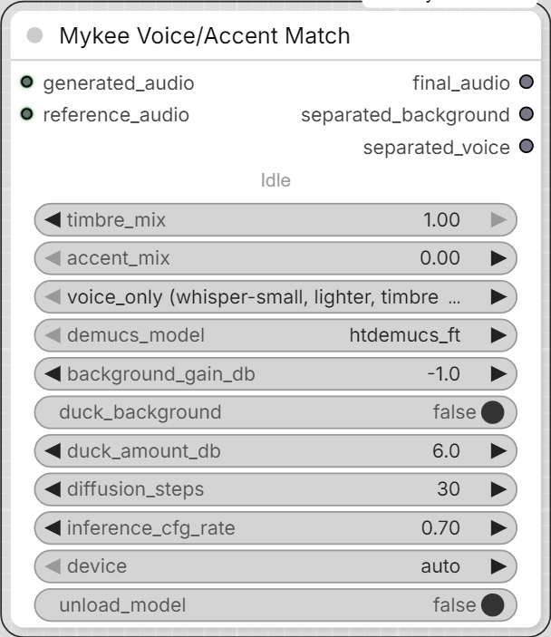

# Mykee Voice/Accent Match

[← Back to the main README](../README.md)  ·  Category: `Mykee/Audio`

  

A universal, model-independent post-processor: takes any generated audio
plus a short reference sample and reshapes the generated voice's timbre
and/or pitch-level/accent character to match the reference - regardless of
what produced the generated audio (any TTS model, any generator). Unlike
every other node in this pack, this one is **not** pure signal processing -
it runs real neural models (source separation + a voice-conversion
diffusion model) and needs a CUDA GPU in practice.

**Pipeline:** Demucs separates voice from background on both inputs (so
music/SFX mixed into either track doesn't get treated as speech) -> Seed-VC
(https://github.com/Plachtaa/seed-vc) converts the isolated vocals ->
the converted voice is remixed with the generated audio's own separated
background.

- **generated_audio** / **reference_audio** - two AUDIO inputs. The
  reference does not need to say the same words as the generated audio -
  a few seconds up to about 25 seconds is used; more doesn't help much
  beyond that.
- **timbre_mix** (0-1) - how much of the reference's voice/timbre to
  blend in, continuously between the generated audio's own voice (0.0)
  and the reference's (1.0). Implemented as a linear blend of the two
  audio's CAM++ speaker embeddings before conditioning Seed-VC on it.
- **accent_mix** (0-1) - how much of the reference-vs-source pitch-level
  difference to apply, from none (0.0, keeps the source's own pitch
  level) to all of it (1.0, matches the reference's level exactly).
  Above 0, this uses the heavier whisper-base+F0 Seed-VC variant. Works
  even with `timbre_mix` at 0 - Seed-VC still needs *some* style vector
  to condition on, and at `timbre_mix=0` that's the source's own, so
  timbre stays close to unchanged while pitch still shifts. (Both at 0
  skips Seed-VC entirely and passes the separated voice through
  unconverted.)
- **model_variant** - which Seed-VC checkpoint pair to use. Each bundles
  a specific Whisper size it was trained with (whisper-small for
  voice-only, whisper-base for voice+accent) - these can't be freely
  mixed and matched, so this isn't a general "pick any Whisper size"
  control the way the name might suggest. Ignored (the F0 variant is
  used automatically) whenever `accent_mix` is above 0.
- **demucs_model** - separation model (`htdemucs_ft` default, higher
  quality but slower).
- **background_gain_db** / **duck_background** / **duck_amount_db** - same
  mixing mechanism as Mykee Audio Merger, applied to the generated audio's
  own separated background when remixing it back under the converted voice.
- **diffusion_steps** / **inference_cfg_rate** - Seed-VC's own
  quality/speed and content-fidelity controls.
- **device** - `auto`/`cuda`/`cpu`. CPU will be extremely slow for this
  pipeline (Demucs + Whisper + a diffusion transformer).
- **unload_model** - frees the Seed-VC and Demucs models from VRAM once
  the run finishes (clears this node's model caches, then asks PyTorch/
  CUDA to actually release the freed memory). Off by default, so repeat
  runs in the same session stay fast; turn it on if you need the VRAM
  back for something else afterward.

A small status line under the node's title (Separating vocals... /
Loading Seed-VC model... / Converting voice... / Mixing... / Done) mirrors
what gets printed to the console, since several of these stages can take
a while. ComfyUI's own native green progress bar (the same one KSampler
shows) tracks the same milestones on top of that.

**Outputs:** `final_audio` (converted voice remixed with the original
background), `separated_background` (generated_audio's background alone,
in case it's useful elsewhere), `separated_voice` (the voice stem after
conversion, before remixing).

**Models:** downloaded automatically on first use into shared,
non-node-specific folders - `ComfyUI/models/whisper/`,
`ComfyUI/models/Seed-VC/`, `ComfyUI/models/CAMpp/`,
`ComfyUI/models/htdemucs/` - so other tools that expect models in those
conventional locations can reuse the same files. The Seed-VC *code*
(not weights) is vendored via a one-time `git clone` into this node
pack's own `third_party/seed-vc/` folder, since it's a full application
repository, not a pip package; that upstream repo was archived
(read-only) in November 2025, so it still works but won't receive
further updates.

Note: on first use, the vendored Seed-VC code also gets a one-time,
automatic rename of its `modules` package, `hf_utils.py`, and
`inference.py` to unique, `mykee_seedvc_`-prefixed names (and every
reference to them rewritten to match). Those are common enough names
that another ComfyUI custom node pack easily ends up using the same
ones - Python caches imported modules by name for the whole process, so
without this, whichever pack imports its own `modules`/`inference`
first would silently "win" and the other would fail to import at all
(`ModuleNotFoundError`) or, worse, load the wrong one.
