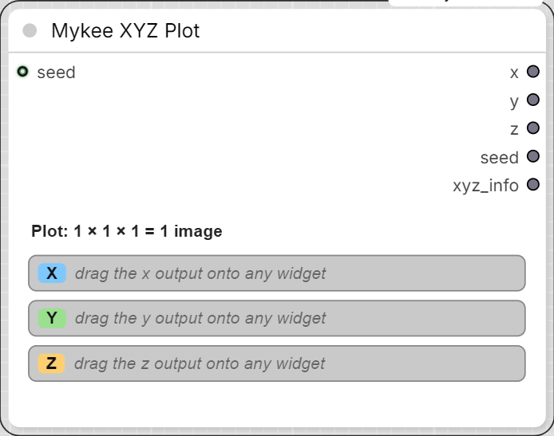
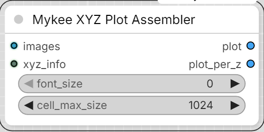

# Mykee XYZ Plot / Mykee XYZ Plot Assembler

[← Back to the main README](../README.md)  ·  Category: `Mykee/Utils`

  
  

A universal XYZ plot: **any widget parameter of any node** can be an axis
(cfg, steps, sampler_name, ckpt_name, lora strength, seed, a prompt text,
a boolean switch, ...). No per-node axis types to pick from a list - you
connect the axis to the parameter itself.

## Setup

1. Add **Mykee XYZ Plot** and drag its **x** / **y** / **z** outputs onto
   the widgets you want to vary (the same way a Primitive node is
   connected). The output takes over the widget's type and name
   (e.g. `x: cfg`), and the node shows an editor for that axis:
   - **INT / FLOAT** - comma separated values and/or ranges:
     `5, 7.5, 10` or `4:12:2` (`start:end:step`, end inclusive). INT axes
     also get a **🎲 random** button (random values, e.g. for a seed axis).
   - **STRING** - one value per line.
   - **combo** (models, samplers, schedulers, LoRAs, ...) - the widget's
     own option list with a filter box, checkboxes and all / none buttons,
     so you can pick e.g. 5 models out of 20.
   - **BOOLEAN** - true / false checkboxes.
   Unused axes simply stay unconnected (an XY or a one-axis plot is fine).
   One axis output can drive several widgets at once, as long as they have
   the same type (and, for combos, the same option list).
2. Connect **xyz_info** to a **Mykee XYZ Plot Assembler**, and the image
   to plot (e.g. the VAE Decode output) to its **images** input.
3. Optional: connect a seed (e.g. from Mykee Seed) to the **seed** input.
   It is passed through on the **seed** output and printed in the plot's
   title.
4. Run. The top of the panel shows the size, e.g. `Plot: 3 × 2 × 2 = 12 images`.

## How a run works

One Run is split into one prompt per cell (Z outermost, X innermost), all
queued at once. In each cell's prompt the axis links are replaced by that
cell's literal value, exactly like a Primitive node would do it. Because of
that, ComfyUI's cache only re-runs what actually changed between two cells:

- **Put the slowest parameter (e.g. the checkpoint) on Z**, then Y: the
  model is loaded once per Z value, not once per cell.
- Every cell is a normal prompt, so a Save Image node after the sampler /
  decoder saves each cell with its own correct metadata.
- Random seeds (Mykee Seed at -1, KSampler "randomize") are resolved once
  per Run, so all cells of a plot use the same seed.

The Assembler shows the partial grid (missing cells in grey) after every
cell. Its outputs are blocked until the last cell has arrived, so a Save
Image node after it only saves the finished table.

Assembler inputs:

- **images** - the cell's image (from a batch, only the first image is used).
- **xyz_info** - from Mykee XYZ Plot.
- **font_size** - label size in pixels, 0 = automatic.
- **cell_max_size** - cells are scaled down to at most this size (longer
  side), 0 = original size. Cells with a different aspect ratio / size are
  letterboxed into the first cell's size.

Assembler outputs:

- **plot** - the whole table in one image: per Z value one grid (column
  headers = X values, row headers = Y values, title = the parameters on the
  axes + seed), stacked below each other.
- **plot_per_z** - the same grids as a batch, one image per Z value.

Notes:

- Only one active Mykee XYZ Plot node per workflow (mute / bypass the
  others). Above 100 cells you are asked to confirm before queueing.
- Model file names are shown without folder and extension in the labels.
- The splitting into cells happens in the ComfyUI frontend. A prompt sent
  directly through the API only renders the first cell.
- After refreshing the model lists, press **↻** on the axis to re-read the
  connected combo's options.
